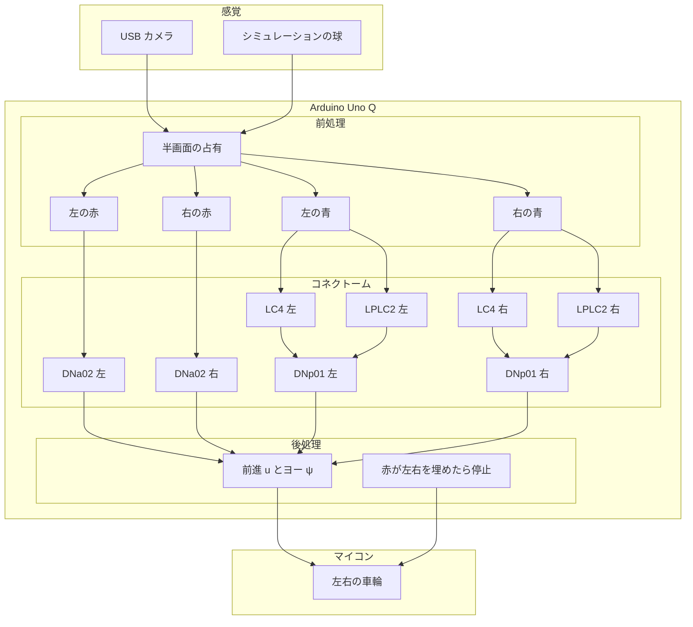
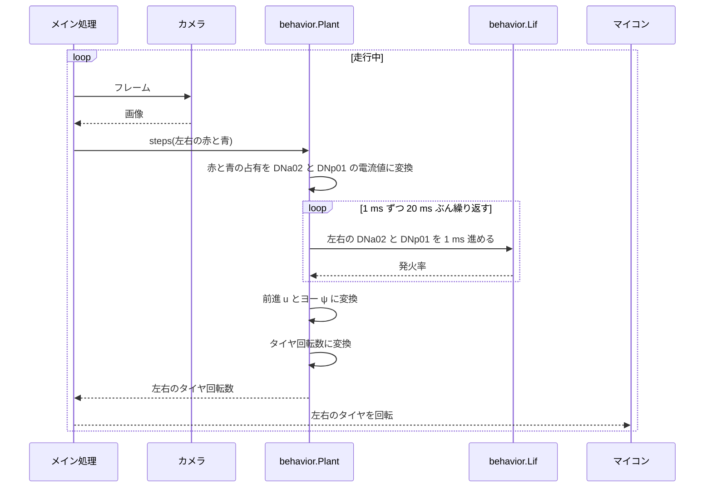

# Fly-Car

オスのショウジョウバエのコネクトームから、カメラの赤と青で走る車をつくる。

## 必要な環境

### Linux と Python

シミュレーションは Linux 上の Python 3.12 で確認している。使うパッケージは `numpy`、`matplotlib`、`japanize-matplotlib`、`pandas`、`pyarrow`、`pytest`、`jupyter` である。`pandas` と `pyarrow` はコネクトームの切り出しと、結合表を読むノートだけで使う。

### Arduino Uno Q

実機は Arduino Uno Q。OS は Debian 13、Python は 3.13。シミュレーションだけならボードは要らない。

### Web カメラ

目の代わりは Logitech Brio 100。対角視野は製品仕様の 58°、取り込みの既定は 1280×720 である。画角のシミュレーションはこの仕様の数字だけを使い、カメラ本体は要らない。撮影の実験では、給電できる USB ハブの先にカメラを置く。

## Preparation

### リポジトリの clone

```bash
git clone https://github.com/hamling-ling/fly-car.git
cd fly-car
```

### Python 環境のセットアップ

```bash
python3 -m pip install numpy matplotlib japanize-matplotlib pandas pyarrow pytest jupyter
```

パッケージ `flycar` は `src/flycar` にある。`pytest` は `pyproject.toml` の `pythonpath` でそこを読む。ノートは同じ `src` を `sys.path` に足す。

### コネクトームの切り出し

結合表の入手、NeuPrint からの取り直し、loom 回路と DNa02 回路の切り出し、LC4 と LPLC2 の画面対応は [scripts/README.md](scripts/README.md) に書いた。画角のシミュレーションと `pytest` は、この表が無くても動く。

## Quick Start

### シミュレーションを動かす

リポジトリ直下で、車輪の固定フレームと基準の画角を確認する。

```bash
python3 -m pytest tests/test_behavior.py tests/test_fov.py
```

絵を見るときは `research/notebooks/fov_sim.ipynb` を開く。球の位置を変えるのは `research/notebooks/fov_scenes.ipynb`。どちらもコネクトームの表は読まない。結合そのものを積分するのは `research/notebooks/gf_loom_sim.ipynb` と `research/notebooks/chemotaxis_sim.ipynb` で、先に [切り出し](scripts/README.md) を済ませる。

ノートはリポジトリ直下か `research/notebooks/` から開く。

### 実機で動かす

本番のアプリは `src/flycar_q/`。起動は [src/flycar_q/README.md](src/flycar_q/README.md)。カメラのフレームを 0.10 秒ごとに読む。赤は左右の占有、青は視角と拡大速度にして、0.02 秒ごとに `Plant.steps` を呼んでパルスをマイコンへ送る。色の範囲は `src/flycar/color_thresholds.json` にあり、`occupancy.py` が読む。`research/color_capture_q/fit_thresholds.py` が色紙の4点からこのファイルを書く。床での走行と、m/s からパルスへの倍率は、まだ合わせていない。ラジコンとモーターの確認は `research/` に残してある。マイコンへ渡す左右の指令をその場で入れるアプリは [research/motor_adjust/README.md](research/motor_adjust/README.md)。直進に揃えた上限、マイコンへ送った指令、前進と後退の生値は [research/notebooks/straight_limits.ipynb](research/notebooks/straight_limits.ipynb)。ラジコンのページでは、その折れ線を右から左への変換としてオンにできる。`src/flycar_q` は送信直前に、同じ折れ線で左の指令を置き換える。

## 内容物

### シミュレーション

| 場所 | 内容 |
|---|---|
| `src/flycar/behavior.py` | 半画面の赤と青から、左右の車輪速度。`Plant.steps` は 20 ms 分 |
| `src/flycar/occupancy.py` | カメラ画像の赤と青の半画面占有。下限は隣の `color_thresholds.json` |
| `src/flycar/pulse.py` | 車輪の m/s をサーボのパルスにする |
| `src/flycar/fov.py` | 地面の球をカメラへ投影し、車を進める |
| `src/flycar/view.py` | 俯瞰、カメラ、ニューロンの図 |
| `research/notebooks/fov_sim.ipynb` | 基準の 1 場面 |
| `research/notebooks/fov_scenes.ipynb` | 球の位置を変えた場面 |
| `research/notebooks/gf_loom_sim.ipynb` | loom 回路の結合と DNp01 |
| `research/notebooks/chemotaxis_sim.ipynb` | 赤と青の机上走行。車輪則はノート側に別にある |
| `tests/` | 固定フレームと基準場面 |

### 実機を使ったキャプチャの実験

Uno Q に Brio 100 を載せて 1 枚取る手順は [research/camera_capture_q/README.md](research/camera_capture_q/README.md)。スクリプトは `research/camera_capture_q/capture.py`。色の見本をボタンでフォルダに分けるアプリは [research/color_capture_q/README.md](research/color_capture_q/README.md)。

### 本番の車

| 場所 | 内容 |
|---|---|
| `src/flycar_q/` | Uno Q に載せるアプリ。カメラ、膜、車輪 |

## システムの解説

走行シミュレーションが毎ステップ掛けているのは、切り出した全シナプスの行列ではない。MaleCNS から残した細胞のうち、赤は DNa02、青は DNp01 で、カメラのカウントをその 4 本の電流にする。結合表を細胞ごとに積分するのは `research/notebooks/gf_loom_sim.ipynb` である。

### システム概要

同じ車輪則を、実機のカメラでも、PC 上の球でも使う。感覚のあとを Arduino Uno Q が受け、前処理、コネクトーム、後処理の 3 層で車輪速度まで出す。車輪を回すのは別のマイコンである。赤の占有は同側の DNa02 へ直接入る。青の占有は同側の LC4 と LPLC2 に同じ率で入り、その 2 種は同側の DNp01 にだけ繋がる。走行則では、その正規化した電流を DNp01 へ占有から直接入れている。辺ごとの積和は `research/notebooks/gf_loom_sim.ipynb` にある。



### シーケンス

図は本番の一周である。`src/flycar_q` がカメラのフレームを取り、`Plant.steps` を 20 ms に 1 回呼ぶ。占有から電流への変換はその窓で 1 回、膜だけを 1 ms ずつ 20 回進め、最後の発火率から前進とヨー、タイヤ速度を 1 回求める。その速度は `flycar.pulse` がサーボのパルスにし、スケッチが車輪を回す。シミュレーションの `fov.simulate` は、これまで通り `Plant.step` を 1 ms ずつ 20 回呼び、途中の速度でも姿勢を進める。カメラの代わりに `fov.project_blob` が地面の球を画面へ投影する。画像の占有は `flycar.occupancy.half_counts` で、半画面の画素数の割合である。



### カメラからコネクトームへの入力

赤は半画面の占有である。画面の水平を $n_x$、垂直を $n_y$ とし、どちらも $[-1,1]$ である。右が正、上が正。カウント $c$ は、球の投影が左右どちらかの半画面と重なる水平幅を、その半画面の幅 1 で割ったものである。縦にはみ出しても幅は減らさない。画面の外は 0。範囲は 0 から 1。

カメラの床 $\theta$ 未満は、赤の電流にする前に空とみなす。この値はカメラを繋いだときに合わせる。数は巻末の表にある。

$$
\tilde{c} =
\begin{cases}
0 & c < \theta \\
c & c \ge \theta
\end{cases}
$$

赤は DNa02。左右で 1 本ずつ。半画面の占有が $c_{\mathrm{ref}}$ のとき電流が 1 になる。

$$
I^{\mathrm{DNa02}}_{L,R} = \tilde{c}^{\mathrm{red}}_{L,R} / c_{\mathrm{ref}}
$$

青は DNp01 だが、占有では電流にしない。一番大きい青い領域を一つの円とみなし、視角 $\theta$（全角）と、前のフレームからの拡大速度 $\dot\theta$ を出す。LC4 は拡大速度のシグモイド、LPLC2 は視角 40° を山にするガウス関数である。$f_i$ は、その細胞の列のうち数える割合である。LPLC2 は画素が青の列を数える。LC4 も、点が片側に寄っているときは画素が青の列を数える。点がだいたい真ん中のときは、LC4 の $f_i$ は画素ではなく、画像の横位置 $u$ が $0.5 \pm 2\sigma$ に入る列の割合である。$\sigma = 0.111$ で、注意して合わせた紙の中心 $u = 0.611$ を $1\sigma$ にしてある。帯は $u$ の 0.278 から 0.722 である。だいたい真ん中とは、その領域の点を $u = 0.5$ で分けたとき、少ない側が多い側の 1/4 以上であることである。これを、その細胞から同側の DNp01 への化学シナプス数 $w_i$ に掛け、側の LC4 と LPLC2 の合計 $W_{\mathrm{side}}$ で割って足す。円の外でも、画素が青なら LPLC2 とその片側の LC4 はその列を数える。マスクの無い幾何の円は、円の内側の列を数える。

$$
s(\dot\theta)=\frac{\sigma(\dot\theta)-\sigma(0)}{1-\sigma(0)},\quad
\sigma(\dot\theta)=\frac{1}{1+\exp(-(\dot\theta-m)/w)}
$$

$$
g(\theta)=\exp\left(-\frac12\left(\frac{\theta_{\deg}-40}{20}\right)^2\right)
$$

$$
I^{\mathrm{DNp01}}
=\frac{100}{50}\left(
6\,s(\dot\theta)\,\frac{\sum w_i^{\mathrm{LC4}} f_i}{W_{\mathrm{side}}}
+g(\theta)\,\frac{\sum w_i^{\mathrm{LPLC2}} f_i}{W_{\mathrm{side}}}
\right)
$$

ノートのシグモイドは中心 $8\,\mathrm{rad/s}$、幅 $5\,\mathrm{rad/s}$、電流の比は $80/50$ である。このカメラは青が画面を埋めると視角が約 40° で頭打ちになり、手で近づけても拡大は 1 rad/s 前後までしか出ない。車の中心は $m = 0.20\,\mathrm{rad/s}$、幅は $w = 0.10\,\mathrm{rad/s}$ である。LC4 の項だけをさらに 6 倍する。5 倍では正面の 22° が拡大 0.4 rad/s で閾値を超えた。6 倍は、手で狙った紙の弱い側も、画素が青の列で数えると閾値を少し超えるように手で置いた数である。正面で左右に割れた 22° が拡大 0.4 rad/s のとき、強い側の電流は約 1.77 になる。右目の中央に置いた 20° は、同じ拡大で約 4.28 になる。止めたままは約 0.41 である。この紙では 20° がおよそ 50 cm にあたる。右目の中央の 10° は、拡大を最大にすると約 1.39 で閾値を超える。電流の比は $100/50 = 2.0$ で、ノートの $1.6$ より大きい。正面のカードは左右の眼に割れて、比が $1.6$ のとき電流が $0.98$ で止まっていた。$2.0$ にするとその行は約 $1.22$ になる。どれも手で置いた数で、この細胞へのフィットではない。山の 40° と幅 20° はノートのままである。拡大が 0 のとき $s$ は 0 なので、LPLC2 だけでは電流が 1 に届かない。止まった青は避けない。左眼が埋まった停止は約 0.82、右眼が埋まった停止は約 0.91 である。同じ全面が拡大 0.2 rad/s だと、左は約 3.86、右は約 3.69 で閾値を超える。u が 0.42 から 0.80 の紙は、点の比が 1/4 を超えるので LC4 は ±2σ の帯を数える。拡大 0.9 rad/s では電流が約 2.82 と約 3.03 になり、パルスはおよそ −92 と −95 でまっすぐ下がる。真ん中をまたがない右の紙は画素の列のままで、左の電流は 0 である。画面上の位置は [scripts/README.md](scripts/README.md) の列対応で、車が読む表は `src/flycar/loom_cells.npz` である。

膜は電流入力の LIF で、時定数 $\tau = 5\,\mathrm{ms}$、閾値 1、不応期 5 ms、刻み $\Delta t = 1\,\mathrm{ms}$ である。

$$
v \leftarrow v + \frac{\Delta t}{\tau}(-v + I)
$$

$v \ge 1$ でスパイクし、$v$ を 0 に戻す。発火率 $r$ はスパイク列の低域通過で、時定数 $\tau_r = 50\,\mathrm{ms}$ である。ノートの 100 ms より短い。拡大は 0.1 秒ごとに更新され、同じフレームをもう一度見ると 0 に戻る。50 ms ならその 1 回の拡大で発火率が車輪の床まで上がる。手で置いた数で、フィットではない。スパイクの瞬間だけ $s = 1$、それ以外は $s = 0$ とする。

$$
r \leftarrow r + \frac{\Delta t}{\tau_r}\left(-r + \frac{s}{\Delta t}\right)
$$

平均すれば $r$ は Hz になる。電流が 1 ちょうどでは $v$ は 1 に届かず、スパイクしない。

### コネクトームの出力からモーターへ

4 本の発火率から経路の速度 $v$（m/s、前が正）と左右の車輪を同時に出す。モードを選ぶ分岐は無い。

$$
u = (r^{\mathrm{DNa02}}_L + r^{\mathrm{DNa02}}_R) - \beta_u\,(r^{\mathrm{DNp01}}_L + r^{\mathrm{DNp01}}_R)
$$

$$
\psi_r = \beta_r\,(r^{\mathrm{DNa02}}_L - r^{\mathrm{DNa02}}_R)
$$

$$
\psi_b = \beta_b\, b\,(r^{\mathrm{DNp01}}_R - r^{\mathrm{DNp01}}_L)
$$

$b$ は 0 か 1 である。大きい方の DNp01 電流が正で、小さい方がその $\rho$ 倍以上なら 0。左右の青がともに `BLUE_SHARE` 以上のときも 0。それ以外は 1。電流が両方 0 のときは 1 で、発火率も 0 である。

$$
v = k_v\, u, \qquad \omega_r = k_\omega\, \psi_r, \qquad \omega_b = k_\omega\, \psi_b
$$

軌間 $d$ の左右輪は次のとおり。赤のヨーは両輪に分ける。青のヨーは、強い眼と反対の輪にだけ後退を足す。$\omega_b > 0$ は右の DNp01 が強いときで、左輪から $\omega_b\, d / 2$ を引く。$\omega_b < 0$ のときは右輪から同じ大きさを引く。

$$
v_L = v - \omega_r\, d / 2, \qquad v_R = v + \omega_r\, d / 2
$$

$$
\omega_b > 0 \implies v_L \leftarrow v_L - \omega_b\, d / 2
$$

$$
\omega_b < 0 \implies v_R \leftarrow v_R - |\omega_b|\, d / 2
$$

車体のヨー $\omega$（rad/s、左が正）は車輪から戻す。青だけのとき、これは $\omega_b$ の半分になる。近い側の輪は経路速度のままだからである。

$$
\omega = (v_R - v_L) / d
$$

右の赤は $r^{\mathrm{DNa02}}_R$ を増やして右へ回る。両輪は前を向いたまま、回転半径は $k_v / (\beta_r k_\omega)$ である。右の DNp01 は左輪に後退を足して左へ回る。右輪は経路速度のままである。赤が無いとき経路速度は負なので、右輪も少し下がり、左輪はそれより強く下がる。青はどちらの輪も前へ回さない。青の和は $\beta_u$ 倍して前進から引く。$\beta_u$ は 1 より小さいので、同じ発火率では赤の和が残る。右の DNp01 が頭打ちで、正面の赤があるとき、経路速度は前を向いたまま、左輪だけが後退する。青が写っているだけでは DNp01 は発火しない。$u$ が負のときも同じ $k_v$ を掛けるので、車は後退する。左右の DNp01 が同じ発火率なら青のヨーは打ち消され、まっすぐ下がる。弱い電流が強い電流の $\rho$ 倍以上のときも $b$ が 0 になり、発火率が揃っていなくても青のヨーは出ない。車は向きを変えずに下がる。負のパルスは折れ線のあとで −36 ずらして送る。0 は 0 のまま止まる。弱い電流が $\rho$ 倍未満のときだけ片側のヨーが残る。両輪は後退のままで、脅威と反対の輪がより強く下がる。

例外が一つある。床を通したあと赤の左右がどちらも $c_{\mathrm{stop}}$ 以上なら、発火していても車輪を止める。

$$
\min(\tilde{c}^{\mathrm{red}}_L,\ \tilde{c}^{\mathrm{red}}_R) \ge c_{\mathrm{stop}} \implies v = 0,\ \omega = 0
$$

図に出す「停止」「旋回」「前進」「後退」は、この車輪の符号へ後から付けた名前である。車輪の指令には戻らない。

## 定数

走行則の式に入れた数。膜の時定数 $\tau = 5\,\mathrm{ms}$、不応期 5 ms、刻み $\Delta t = 1\,\mathrm{ms}$、発火率の時定数 $\tau_r = 50\,\mathrm{ms}$ は上の式のそばに書いた。

| 記号 | コード | 意味 | 値 |
|---|---|---|---|
| $\theta$ | `COUNT_FLOOR` | 半画面の占有がこれ未満なら空 | 0.04 |
| $c_{\mathrm{ref}}$ | `RED_REF` | この赤の占有で DNa02 の電流が 1 | 0.04 |
| $m$ | `EARLY_MID` | LC4 のシグモイドの中心 | 0.20 rad/s |
| $w$ | `EARLY_WIDTH` | その幅 | 0.10 rad/s |
| | `LC4_GAIN` | 拡大の項だけに掛ける係数 | 6 |
| $\sigma$ | `CENTER_SIGMA` | 真ん中にかざした位置の標準偏差。ちょい右の 0.111 を $1\sigma$ とする | 0.111 |
| | `CENTER_RATIO` | 点の少ない側が多い側のこの割合以上なら、LC4 は $\pm 2\sigma$ の帯を数える | 0.25 |
| | `LPLC2_SHARE` | 両眼の視角の項が `SIZE_BOTH` 以上のとき、その項に掛ける係数 | 3 |
| | `SIZE_BOTH` | この電流以上が左右そろった止まった青だけ、視角の項を増やす | 0.5 |
| | `SIZE_PEAK_DEG` | LPLC2 の山 | 40° |
| | `SIZE_SIGMA_DEG` | その幅 | 20° |
| | `R_MAX`, `R_REF` | 電流に残る比 | 100 Hz / 50 Hz |
| $\beta_u$ | `BLUE_FORWARD` | 青の和を前進から引く係数 | 0.35 |
| $\beta_r$ | `RED_YAW` | 赤の左右差のヨー係数 | 1.25 |
| $\beta_b$ | `BLUE_YAW` | 青の左右差。強い眼と反対の輪にだけ後退を足す | 18 |
| $\rho$ | `BILATERAL_RATIO` | 弱い電流が強い電流のこの割合以上なら $b = 0$ | 0.25 |
| | `BLUE_SHARE` | 左右の青がともにこの占有以上なら、電流の比が $\rho$ 未満でも $b = 0$ | 0.15 |
| $k_v$ | `FORWARD_PER_HZ` | 発火率から前進速度 | 0.0006 m/s/Hz |
| $k_\omega$ | `YAW_PER_HZ` | 発火率からヨー角速度 | 0.0024 rad/s/Hz |
| $c_{\mathrm{stop}}$ | `RED_FILL` | 左右の赤がともにこれ以上なら停止 | 0.75 |
| $d$ | `TRACK` | 軌間 | 0.12 m |

赤だけが片側で発火しているときの回転半径 $k_v / (\beta_r k_\omega)$ は 0.20 m。0.10 m では斜め前の赤に対して向きが速すぎ、紙が画面の外へ出た。軌間の半分より大きいので両輪は前を向き、内側は経路速度の 0.7 倍になる。$\beta_b = 18$ は、ヨーを両輪に分けていたときに、電流 1.8 前後が 0.1 秒続いた回頭が約 30° になる数である。3.6 では同じスパイク列が約 6° で、車体は少し動いて止まった。青のヨーは強い眼と反対の輪にだけ後退を足すので、車体の回頭は約 15° になる。遠い側の輪の後退の大きさは、分けていたときのその輪と同じである。角度は係数に比例する。拡大が 0.1 秒より長く続けば、そのぶん足される。片側の青では両輪とも後退し、近い側は青の和のぶんだけ下がる。$\rho = 0.25$ も手で置いた数で、弱い電流が強い電流のその割合以上なら $b$ を 0 にする。視角 22° で画面中心から約 1° ずれると、電流は約 1.77 と約 1.14 で、比は $\rho$ より大きい。22° で中心から約 3° 以内は回頭しない。負の指令は −36 ずらして送るので、約 1° のずれはパルスおよそ −69 と −71 でまっすぐ下がる。25° で約 1° のずれはおよそ −79 と −82、30° で約 1° のずれは経路速度約 −0.065 m/s、パルスおよそ −88 と −91 である。端の青は電流の比が $\rho$ より小さく、弱い側の占有も `BLUE_SHARE` 未満なので、脅威と反対の輪がより強く下がる。左右の青がともに 0.15 以上なら、弱い側の電流が 0 でも青のヨーは出さない。0.15 は、正面に出した紙のマスクが片側に寄り、弱い側の青が 0.15 で電流が 0 のまま大きく回ったログに合わせて手で置いた数である。弱い側が 0.05 のような端の青は、両輪が後退したまま避ける。画面を覆う止まった青は片眼あたり約 0.7 で閾値の下になり、発火が消えて後退パルスは −36 に届かなかった。両眼の視角の項がともに 0.5 以上のときだけ、その項を 3 倍する。これはおよそ 38° より近い正面の紙で、画面いっぱいでは電流が約 2 になり、送るパルスはおよそ −81 と −84 である。片眼だけの止まった青は 3 倍せず、閾値の下のままである。3 も手で置いた数である。視角の項に掛けるのは 0 か 3 で、0 と 1 のあいだの倍率は使っていない。
