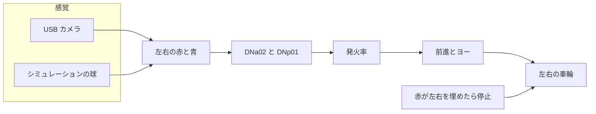
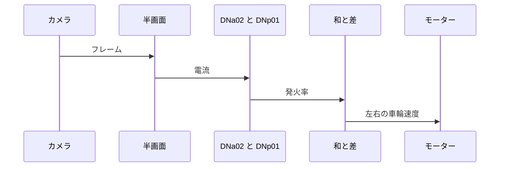

# Fly-Car

オスのショウジョウバエのコネクトームから、カメラの赤と青で走る車をつくる。

## 必要な環境

### Linux と Python

シミュレーションは Linux 上の Python 3.12 で確認している。使うパッケージは `numpy`、`matplotlib`、`japanize-matplotlib`、`pandas`、`pyarrow`、`pytest`、`jupyter` である。`pandas` と `pyarrow` はコネクトームの切り出しと、結合表を読むノートだけで使う。

### Arduino Uno Q

実機は Arduino Uno Q。OS は Debian 13、Python は 3.13。シミュレーションだけならボードは要らない。

### Web カメラ

目の代わりは Logitech Brio 100。対角視野は製品仕様の 58°、取り込みの既定は 1280×720 である。画角のシミュレーションはこの仕様の数字だけを使い、カメラ本体は要らない。撮影の実験では、給電できる USB ハブの先にカメラを置く。

## Preparation

### リポジトリの clone

```bash
git clone https://github.com/hamling-ling/fly-car.git
cd fly-car
```

### Python 環境のセットアップ

```bash
python3 -m pip install numpy matplotlib japanize-matplotlib pandas pyarrow pytest jupyter
```

### コネクトームの切り出し

結合表の入手、NeuPrint からの取り直し、loom 回路と DNa02 回路の切り出しは [scripts/README.md](scripts/README.md) に書いた。画角のシミュレーションと `pytest` は、この表が無くても動く。

## Quick Start

### シミュレーションを動かす

リポジトリ直下で、車輪の固定フレームと基準の画角を確認する。

```bash
python3 -m pytest tests/test_behavior.py tests/test_fov.py
```

絵を見るときは `notebooks/fov_sim.ipynb` を開く。球の位置を変えるのは `notebooks/fov_scenes.ipynb`。どちらもコネクトームの表は読まない。結合そのものを積分するのは `notebooks/gf_loom_sim.ipynb` と `notebooks/chemotaxis_sim.ipynb` で、先に [切り出し](scripts/README.md) を済ませる。

ノートはリポジトリ直下か `notebooks/` から開く。

### 実機で動かす

これから。カメラで止めて、車輪まで出すところはまだ車体に載っていない。

## 内容物

### シミュレーション

| 場所 | 内容 |
|---|---|
| `flycar/behavior.py` | 半画面の赤と青から、左右の車輪速度 |
| `flycar/fov.py` | 地面の球をカメラへ投影し、車を進める |
| `flycar/view.py` | 俯瞰、カメラ、ニューロンの図 |
| `notebooks/fov_sim.ipynb` | 基準の 1 場面 |
| `notebooks/fov_scenes.ipynb` | 球の位置を変えた場面 |
| `notebooks/gf_loom_sim.ipynb` | loom 回路の結合と DNp01 |
| `notebooks/chemotaxis_sim.ipynb` | 赤と青の机上走行。車輪則はノート側に別にある |
| `tests/` | 固定フレームと基準場面 |

### 実機を使ったキャプチャの実験

Uno Q に Brio 100 を載せて 1 枚取る手順は [research/camera_capture_q/README.md](research/camera_capture_q/README.md)。スクリプトは `research/camera_capture_q/capture.py`。

### 実機で動かす

これから。

## システムの解説

走行シミュレーションが毎ステップ掛けているのは、切り出した全シナプスの行列ではない。MaleCNS から残した細胞のうち、赤は DNa02、青は DNp01 で、カメラのカウントをその 4 本の電流にする。結合表を細胞ごとに積分するのは `notebooks/gf_loom_sim.ipynb` である。

### ブロック図

同じ車輪則を、実機のカメラでも、PC 上の球でも使う。



### データの流れ

1 フレームの中身は次の順で渡る。膜の刻みは 1 ms、絵を測る間隔は 20 ms で、そのあいだカウントは固定する。



### カメラからコネクトームへの入力

画面の水平を $n_x$、垂直を $n_y$ とし、どちらも $[-1,1]$ である。右が正、上が正。カウント $c$ は、球の投影が左右どちらかの半画面と重なる水平幅を、その半画面の幅 1 で割ったものである。縦にはみ出しても幅は減らさない。画面の外は 0。範囲は 0 から 1。

カメラの床 $\theta = 0.15$ 未満は、電流にする前に空とみなす。この値はカメラを繋いだときに合わせる。

$$
\tilde{c} =
\begin{cases}
0 & c < \theta \\
c & c \ge \theta
\end{cases}
$$

赤は DNa02、青は DNp01。左右で 1 本ずつ、合わせて 4 本ある。赤の電流は、カウントが `RED_REF` $= 0.15$ のとき 1 になるように割る。青の電流は、同側の LC4 と LPLC2 を一つの率 $R_{\max} = 80\,\mathrm{Hz}$ にまとめたものを、参照 $R_{\mathrm{ref}} = 50\,\mathrm{Hz}$ で割る。

$$
I^{\mathrm{DNa02}}_{L,R} = \tilde{c}^{\mathrm{red}}_{L,R} / 0.15
$$

$$
I^{\mathrm{DNp01}}_{L,R} = \tilde{c}^{\mathrm{blue}}_{L,R} \times 80 / 50
$$

膜は電流入力の LIF で、時定数 $\tau = 5\,\mathrm{ms}$、閾値 1、不応期 5 ms、刻み $\Delta t = 1\,\mathrm{ms}$ である。

$$
v \leftarrow v + \frac{\Delta t}{\tau}(-v + I)
$$

$v \ge 1$ でスパイクし、$v$ を 0 に戻す。発火率 $r$ はスパイク列の低域通過で、時定数 $\tau_r = 100\,\mathrm{ms}$ である。スパイクの瞬間だけ $s = 1$、それ以外は $s = 0$ とする。

$$
r \leftarrow r + \frac{\Delta t}{\tau_r}\left(-r + \frac{s}{\Delta t}\right)
$$

平均すれば $r$ は Hz になる。電流が 1 ちょうどでは $v$ は 1 に届かず、スパイクしない。

### コネクトームの出力からモーターへ

4 本の発火率から前進 $v$（m/s、前が正）とヨー $\omega$（rad/s、左が正）を同時に出す。モードを選ぶ分岐は無い。

$$
u = (r^{\mathrm{DNa02}}_L + r^{\mathrm{DNa02}}_R) - (r^{\mathrm{DNp01}}_L + r^{\mathrm{DNp01}}_R)
$$

$$
\psi = (r^{\mathrm{DNa02}}_L - r^{\mathrm{DNa02}}_R) + (r^{\mathrm{DNp01}}_R - r^{\mathrm{DNp01}}_L)
$$

$$
v = \max(0,\ 0.0006\, u), \qquad \omega = 0.0024\, \psi
$$

右の赤は $r^{\mathrm{DNa02}}_R$ を増やして右へ回る。右の青は $r^{\mathrm{DNp01}}_R$ を増やして左へ回る。青の和は前進を削る。負の $u$ は 0 にするので、後退はしない。片側だけが発火しているときの回転半径は $0.0006 / 0.0024 = 0.25\,\mathrm{m}$ である。

例外が一つある。床を通したあと赤の左右がどちらも 0.75 以上なら、発火していても車輪を止める。

$$
\min(\tilde{c}^{\mathrm{red}}_L,\ \tilde{c}^{\mathrm{red}}_R) \ge 0.75 \implies v = 0,\ \omega = 0
$$

軌間 $d = 0.12\,\mathrm{m}$ の左右輪は次のとおり。$\omega > 0$ のとき右輪が速い。

$$
v_L = v - \omega\, d / 2, \qquad v_R = v + \omega\, d / 2
$$

図に出す「停止」「その場旋回」「前進」は、この車輪の符号へ後から付けた名前である。車輪の指令には戻らない。
