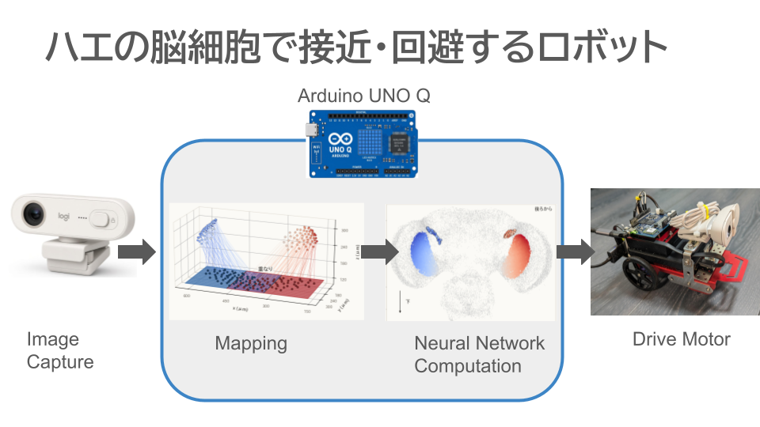
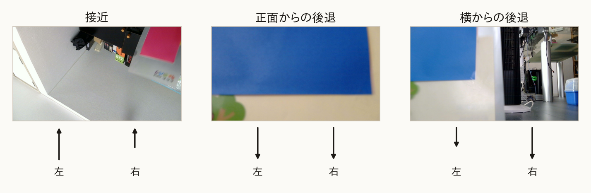
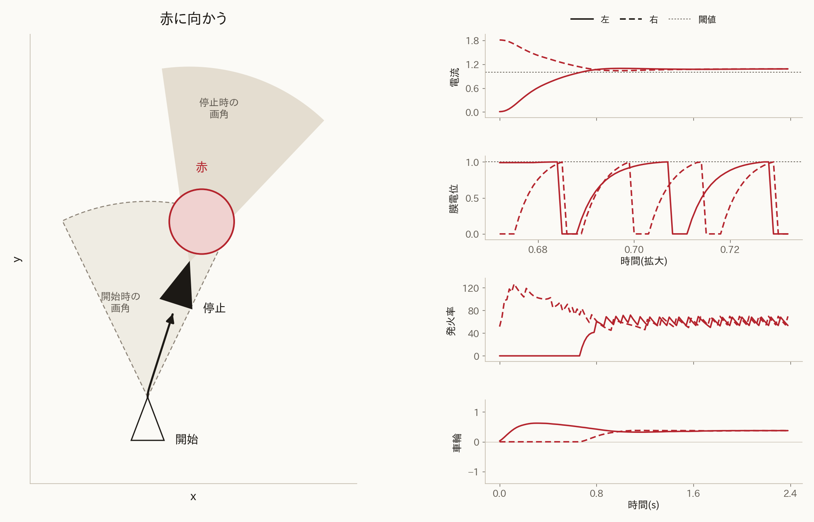
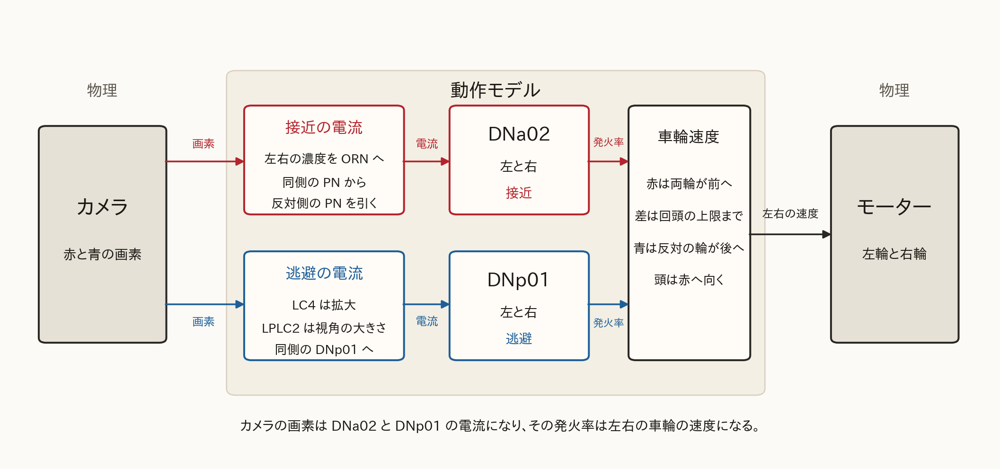

# Fly-Car

オスのショウジョウバエのコネクトームから取った回路で、接近と逃避をする二輪ロボット。

[](https://www.youtube.com/watch?v=30UnHq7dWzU)

コネクトームは、脳の細胞同士を結ぶ化学シナプスの数を数えた接続表である（[Berg et al., 2026](https://doi.org/10.1016/j.cell.2026.08.015)）。このロボットは、その接続表のうち視覚細胞から下降ニューロンまでの接続を使い、カメラの赤を誘引物質への嗅覚入力の代わりに、近づいてくる青い対象を逃避の引き金にして動く。モデルの式と数値計算、実機の記録は [ポスター原稿](poster/poster.md) にある。要点だけの [簡易版ポスター](poster/simple_poster.md) もある。

## 接近と逃避

赤が画面の片側にあると、車はその側へ向きを変えながら近づく。赤い側の車輪は止まり、反対の車輪が前へ出るので、旋回半径は車輪間隔の半分が下限になる。赤が中心に来ると、左右の車輪が同じ速さで前へ出て、まっすぐ近づく。

青が近づいてくると、車は下がる。片側の青では、反対の車輪が後ろへ出て、頭は青から逸れる。正面の青では、両輪が揃って後ろへ出る。止まっている青には反応しない。下がるのは、青の像が広がっているあいだだけである。



数値計算は、赤に向かう場合、正面の青から遠ざかる場合、横の青から回避する場合の三場面である。各図の左が経路、右が電流、膜電位、発火率、左右の車輪速度である。



## モデル

カメラの画像は、嗅覚受容ニューロン ORN と投射ニューロン PN（赤の経路）、視葉の LC4 と LPLC2（青の経路）を通り、接近の下降ニューロン DNa02 と逃避の下降ニューロン DNp01 の電流になる。四つの下降ニューロンの発火率が、左右の車輪速度になる。



赤の経路では、画面を左右の眼の範囲に分ける。範囲は中央で重なり、左は左端から 0.65 まで、右は 0.35 から右端までである。各範囲の赤の割合が、その側の触角への入力の代わりになる。割合は PN で飽和し、同側の PN が促進、反対側の PN が抑制として、同側の DNa02 に入る。赤の重心が端に寄るほど、左右の割合には同じ倍率が掛かる（中央では 1）。

青の経路では、各細胞の画面位置にある青の割合を読む。LC4 は像の拡大の速さに、LPLC2 は広がっている像の大きさに応答する。LPLC2 の応答は、像が止まっているときは弱く、拡大が始まると強くなる。二つの応答の和が同側の DNp01 の電流になる。細胞ごとの重みは、コネクトームで数えた、その細胞から同側の DNp01 への化学シナプスの数である。

下降ニューロンの膜は四本とも互いにつながらず、同じ漏れ積分発火で計算する。車輪は発火率だけを読む。左の車輪は右の DNa02 から右の DNp01 を引いた発火率、右の車輪はその左右を入れ替えたものに従う。DNa02 は前進、DNp01 は後退である。車輪指令を平滑したあと、回転が安全上限を超えたときだけ、平均の速さを保って左右の差を縮める。赤が左右の範囲とも満ちているときは、安全のため両輪を止める。

係数は `src/flycar/behavior.py` と `src/flycar/loom.py`、実機の周期は `src/flycar_q/python/config.py` にある。

## 必要な環境

- シミュレーション: Linux と Python 3.12。パッケージは `numpy`、`matplotlib`、`japanize-matplotlib`、`pandas`、`pyarrow`、`pytest`、`jupyter`。`pandas` と `pyarrow` は、コネクトームの切り出しと結合表を読むノートだけで使う
- 実機: Arduino Uno Q（Debian 13、Python 3.13）。シミュレーションだけならボードは要らない
- カメラ: Logitech Brio 100。対角視野は製品仕様の 58°、取り込みは 1280×720。画角のシミュレーションはこの仕様の数字だけを使い、カメラ本体は要らない。撮影の実験では、給電できる USB ハブの先にカメラを置く

## 準備

```bash
git clone https://github.com/hamling-ling/fly-car.git
cd fly-car
python3 -m pip install numpy matplotlib japanize-matplotlib pandas pyarrow pytest jupyter
```

パッケージ `flycar` は `src/flycar` にある。`pytest` は `pyproject.toml` の `pythonpath` でそこを読む。ノートは同じ `src` を `sys.path` に足す。

コネクトームの結合表の入手、NeuPrint からの取り直し、loom 回路と DNa02 回路の切り出し、LC4 と LPLC2 の画面対応は [scripts/README.md](scripts/README.md) に書いた。画角のシミュレーションと `pytest` は、この表が無くても動く。

## 動かし方

### シミュレーション

リポジトリ直下で、車輪の固定フレームと基準の画角を確認する。

```bash
python3 -m pytest tests/test_behavior.py tests/test_fov.py
```

絵を見るときは `research/notebooks/fov_sim.ipynb` を開く。球の位置を変えるのは `research/notebooks/fov_scenes.ipynb`。どちらもコネクトームの表は読まない。結合そのものを積分するのは `research/notebooks/gf_loom_sim.ipynb` と `research/notebooks/chemotaxis_sim.ipynb` で、先に切り出しを済ませる。ノートはリポジトリ直下か `research/notebooks/` から開く。

### 実機

本番のアプリは `src/flycar_q/` にあり、起動方法は [src/flycar_q/README.md](src/flycar_q/README.md) にある。カメラのフレームは `COUNT_S` ごとに読み、膜は `TICK_S` ごとに `Plant.steps` を呼んでパルスをマイコンへ送る。二つの定数は `src/flycar_q/python/config.py` にある。

色の範囲は `src/flycar/color_thresholds.json` にあり、`occupancy.py` が読む。`research/color_capture_q/fit_thresholds.py` が色紙の4点からこのファイルを書く。

床での走行と、m/s からパルスへの倍率は、まだ合わせていない。ラジコンとモーターの確認は `research/` に残してある。マイコンへ渡す左右の指令をその場で入れるアプリは [research/motor_adjust/README.md](research/motor_adjust/README.md)。直進に揃えた上限、マイコンへ送った指令、前進と後退の生値は [research/notebooks/straight_limits.ipynb](research/notebooks/straight_limits.ipynb)。ラジコンのページでは、その折れ線を右から左への変換としてオンにできる。`src/flycar_q` は送信直前に、同じ折れ線で左の指令を置き換える。

## 内容物

### シミュレーション

| 場所 | 内容 |
|---|---|
| `src/flycar/behavior.py` | 左右の眼の赤の濃度と、青の視角・拡大から、左右の車輪速度。膜と車輪の刻みはファイルの先頭 |
| `src/flycar/loom.py` | 青の領域から、LC4 と LPLC2 を経て DNp01 の電流を出す |
| `src/flycar/occupancy.py` | カメラ画像の赤と青を、中央で重なる左右の眼の範囲で数える。色の範囲は隣の `color_thresholds.json` |
| `src/flycar/pulse.py` | 車輪の m/s をサーボのパルスにする |
| `src/flycar/fov.py` | 地面の球をカメラへ投影し、車を進める |
| `src/flycar/view.py` | 俯瞰、カメラ、ニューロンの図 |
| `research/notebooks/fov_sim.ipynb` | 基準の 1 場面 |
| `research/notebooks/fov_scenes.ipynb` | 球の位置を変えた場面 |
| `research/notebooks/gf_loom_sim.ipynb` | loom 回路の結合と DNp01 |
| `research/notebooks/chemotaxis_sim.ipynb` | 赤と青の机上走行。車輪則はノート側に別にある |
| `poster/poster.md` | 動作モデルの式、数値計算、実機 |
| `poster/simple_poster.md` | ポスターの簡易版 |
| `tests/` | 固定フレームと基準場面 |

### 実機を使ったキャプチャの実験

Uno Q に Brio 100 を載せて 1 枚取る手順は [research/camera_capture_q/README.md](research/camera_capture_q/README.md)。スクリプトは `research/camera_capture_q/capture.py`。色の見本をボタンでフォルダに分けるアプリは [research/color_capture_q/README.md](research/color_capture_q/README.md)。

### 実機で動かすプログラム

本番の `flycar_q` と、製作の過程で作った確認・調整用のアプリである。

| 場所 | 内容 |
|---|---|
| `src/flycar_q/` | Uno Q に載せる本番のアプリ。カメラ、膜、車輪 |
| `research/motor_test/` | 車輪の前進と後進、ピンとパルスを確認したテスト用アプリ |
| `research/remote_control/` | ラジコン。ブラウザに Brio 100 の映像を出し、十字キーで左右の車輪を動かす |
| `research/motor_adjust/` | 車輪の調整。マイコンへ渡す左右の指令をその場で入れる。カメラは使わない |
| `research/camera_capture_q/` | Uno Q に Brio 100 を載せて 1 枚取るスクリプト |
| `research/color_capture_q/` | 色の見本を取るアプリ。映像を止めて、赤と青を4点で囲んで保存する |
