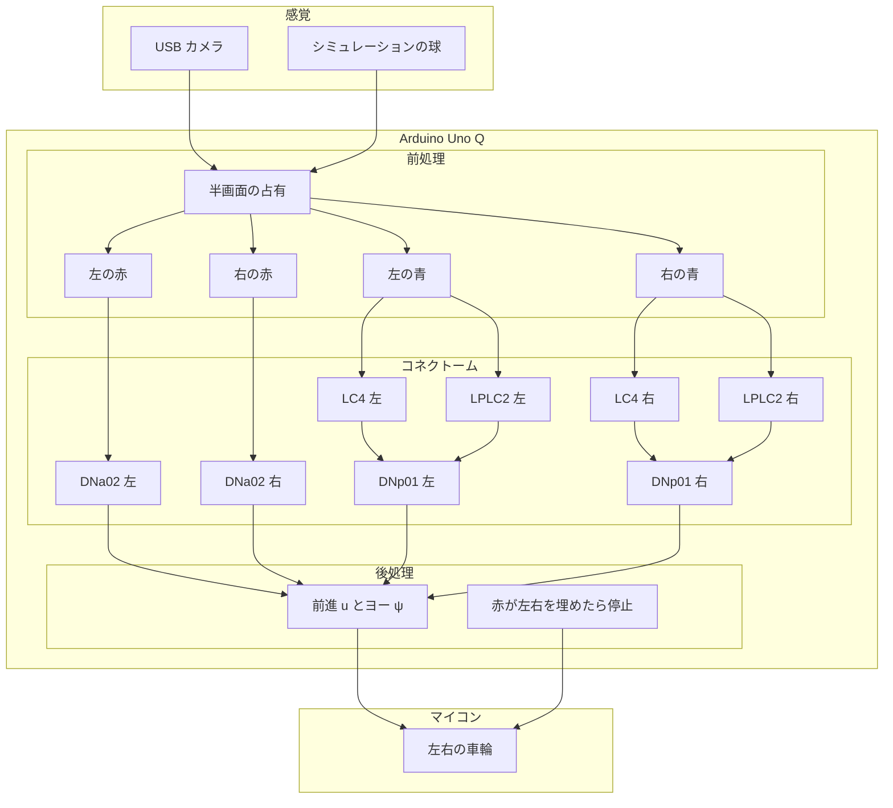
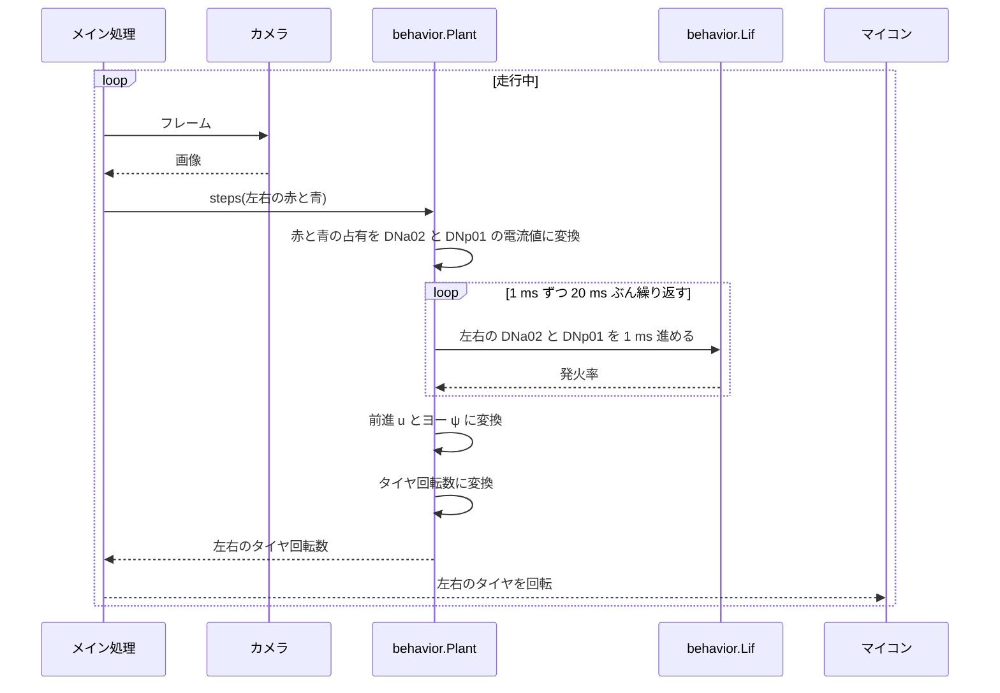

# Fly-Car

オスのショウジョウバエのコネクトームから、カメラの赤と青で走る車をつくる。

## 必要な環境

### Linux と Python

シミュレーションは Linux 上の Python 3.12 で確認している。使うパッケージは `numpy`、`matplotlib`、`japanize-matplotlib`、`pandas`、`pyarrow`、`pytest`、`jupyter` である。`pandas` と `pyarrow` はコネクトームの切り出しと、結合表を読むノートだけで使う。

### Arduino Uno Q

実機は Arduino Uno Q。OS は Debian 13、Python は 3.13。シミュレーションだけならボードは要らない。

### Web カメラ

目の代わりは Logitech Brio 100。対角視野は製品仕様の 58°、取り込みの既定は 1280×720 である。画角のシミュレーションはこの仕様の数字だけを使い、カメラ本体は要らない。撮影の実験では、給電できる USB ハブの先にカメラを置く。

## Preparation

### リポジトリの clone

```bash
git clone https://github.com/hamling-ling/fly-car.git
cd fly-car
```

### Python 環境のセットアップ

```bash
python3 -m pip install numpy matplotlib japanize-matplotlib pandas pyarrow pytest jupyter
```

パッケージ `flycar` は `src/flycar` にある。`pytest` は `pyproject.toml` の `pythonpath` でそこを読む。ノートは同じ `src` を `sys.path` に足す。

### コネクトームの切り出し

結合表の入手、NeuPrint からの取り直し、loom 回路と DNa02 回路の切り出しは [scripts/README.md](scripts/README.md) に書いた。画角のシミュレーションと `pytest` は、この表が無くても動く。

## Quick Start

### シミュレーションを動かす

リポジトリ直下で、車輪の固定フレームと基準の画角を確認する。

```bash
python3 -m pytest tests/test_behavior.py tests/test_fov.py
```

絵を見るときは `research/notebooks/fov_sim.ipynb` を開く。球の位置を変えるのは `research/notebooks/fov_scenes.ipynb`。どちらもコネクトームの表は読まない。結合そのものを積分するのは `research/notebooks/gf_loom_sim.ipynb` と `research/notebooks/chemotaxis_sim.ipynb` で、先に [切り出し](scripts/README.md) を済ませる。

ノートはリポジトリ直下か `research/notebooks/` から開く。

### 実機で動かす

本番のアプリは `src/flycar_q/`。起動は [src/flycar_q/README.md](src/flycar_q/README.md)。カメラのフレームを 0.10 秒ごとに左右の赤と青にし、0.02 秒ごとに `Plant.steps` を呼んでパルスをマイコンへ送る。色の範囲と、m/s からパルスへの倍率は、まだ床で合わせていない。ラジコンとモーターの確認は `research/` に残してある。

## 内容物

### シミュレーション

| 場所 | 内容 |
|---|---|
| `src/flycar/behavior.py` | 半画面の赤と青から、左右の車輪速度。`Plant.steps` は 20 ms 分 |
| `src/flycar/occupancy.py` | カメラ画像の赤と青の半画面占有 |
| `src/flycar/pulse.py` | 車輪の m/s をサーボのパルスにする |
| `src/flycar/fov.py` | 地面の球をカメラへ投影し、車を進める |
| `src/flycar/view.py` | 俯瞰、カメラ、ニューロンの図 |
| `research/notebooks/fov_sim.ipynb` | 基準の 1 場面 |
| `research/notebooks/fov_scenes.ipynb` | 球の位置を変えた場面 |
| `research/notebooks/gf_loom_sim.ipynb` | loom 回路の結合と DNp01 |
| `research/notebooks/chemotaxis_sim.ipynb` | 赤と青の机上走行。車輪則はノート側に別にある |
| `tests/` | 固定フレームと基準場面 |

### 実機を使ったキャプチャの実験

Uno Q に Brio 100 を載せて 1 枚取る手順は [research/camera_capture_q/README.md](research/camera_capture_q/README.md)。スクリプトは `research/camera_capture_q/capture.py`。色の見本をボタンでフォルダに分けるアプリは [research/color_capture_q/README.md](research/color_capture_q/README.md)。

### 本番の車

| 場所 | 内容 |
|---|---|
| `src/flycar_q/` | Uno Q に載せるアプリ。カメラ、膜、車輪 |

## システムの解説

走行シミュレーションが毎ステップ掛けているのは、切り出した全シナプスの行列ではない。MaleCNS から残した細胞のうち、赤は DNa02、青は DNp01 で、カメラのカウントをその 4 本の電流にする。結合表を細胞ごとに積分するのは `research/notebooks/gf_loom_sim.ipynb` である。

### システム概要

同じ車輪則を、実機のカメラでも、PC 上の球でも使う。感覚のあとを Arduino Uno Q が受け、前処理、コネクトーム、後処理の 3 層で車輪速度まで出す。車輪を回すのは別のマイコンである。赤の占有は同側の DNa02 へ直接入る。青の占有は同側の LC4 と LPLC2 に同じ率で入り、その 2 種は同側の DNp01 にだけ繋がる。走行則では、その正規化した電流を DNp01 へ占有から直接入れている。辺ごとの積和は `research/notebooks/gf_loom_sim.ipynb` にある。



### シーケンス

図は本番の一周である。`src/flycar_q` がカメラのフレームを取り、`Plant.steps` を 20 ms に 1 回呼ぶ。占有から電流への変換はその窓で 1 回、膜だけを 1 ms ずつ 20 回進め、最後の発火率から前進とヨー、タイヤ速度を 1 回求める。その速度は `flycar.pulse` がサーボのパルスにし、スケッチが車輪を回す。シミュレーションの `fov.simulate` は、これまで通り `Plant.step` を 1 ms ずつ 20 回呼び、途中の速度でも姿勢を進める。カメラの代わりに `fov.project_blob` が地面の球を画面へ投影する。画像の占有は `flycar.occupancy.half_counts` で、半画面の画素数の割合である。



### カメラからコネクトームへの入力

画面の水平を $n_x$、垂直を $n_y$ とし、どちらも $[-1,1]$ である。右が正、上が正。カウント $c$ は、球の投影が左右どちらかの半画面と重なる水平幅を、その半画面の幅 1 で割ったものである。縦にはみ出しても幅は減らさない。画面の外は 0。範囲は 0 から 1。

カメラの床 $\theta$ 未満は、電流にする前に空とみなす。この値はカメラを繋いだときに合わせる。数は巻末の表にある。

$$
\tilde{c} =
\begin{cases}
0 & c < \theta \\
c & c \ge \theta
\end{cases}
$$

赤は DNa02、青は DNp01。左右で 1 本ずつ、合わせて 4 本ある。どちらの電流も、半画面の占有が $c_{\mathrm{ref}}$ のとき 1 になるように割る。占有は loom の拡大速度ではないので、青には $R_{\max}/R_{\mathrm{ref}}$ を掛けない。

$$
I^{\mathrm{DNa02}}_{L,R} = \tilde{c}^{\mathrm{red}}_{L,R} / c_{\mathrm{ref}}
$$

$$
I^{\mathrm{DNp01}}_{L,R} = \tilde{c}^{\mathrm{blue}}_{L,R} / c_{\mathrm{ref}}
$$

膜は電流入力の LIF で、時定数 $\tau = 5\,\mathrm{ms}$、閾値 1、不応期 5 ms、刻み $\Delta t = 1\,\mathrm{ms}$ である。

$$
v \leftarrow v + \frac{\Delta t}{\tau}(-v + I)
$$

$v \ge 1$ でスパイクし、$v$ を 0 に戻す。発火率 $r$ はスパイク列の低域通過で、時定数 $\tau_r = 100\,\mathrm{ms}$ である。スパイクの瞬間だけ $s = 1$、それ以外は $s = 0$ とする。

$$
r \leftarrow r + \frac{\Delta t}{\tau_r}\left(-r + \frac{s}{\Delta t}\right)
$$

平均すれば $r$ は Hz になる。電流が 1 ちょうどでは $v$ は 1 に届かず、スパイクしない。

### コネクトームの出力からモーターへ

4 本の発火率から前進 $v$（m/s、前が正）とヨー $\omega$（rad/s、左が正）を同時に出す。モードを選ぶ分岐は無い。

$$
u = (r^{\mathrm{DNa02}}_L + r^{\mathrm{DNa02}}_R) - \beta_u\,(r^{\mathrm{DNp01}}_L + r^{\mathrm{DNp01}}_R)
$$

$$
\psi = \beta_r\,(r^{\mathrm{DNa02}}_L - r^{\mathrm{DNa02}}_R) + \beta_b\,(r^{\mathrm{DNp01}}_R - r^{\mathrm{DNp01}}_L)
$$

$$
v = \max(0,\ k_v\, u), \qquad \omega = k_\omega\, \psi
$$

右の赤は $r^{\mathrm{DNa02}}_R$ を増やして右へ回る。右の青は $r^{\mathrm{DNp01}}_R$ を増やして左へ回る。青の和は $\beta_u$ 倍して前進から引く。$\beta_u$ は 1 より小さいので、同じ発火率では赤の和が残る。赤の半径を縮めた分だけ $\beta_b$ も上げてあり、正面の赤と右の青は、青の左側を両輪前進のまま通る。同じ発火率では $\beta_r$ のほうがわずかに大きい。負の $u$ は 0 にするので、後退はしない。赤の片側だけが発火しているときの回転半径は $k_v / (\beta_r k_\omega)$ である。

例外が一つある。床を通したあと赤の左右がどちらも $c_{\mathrm{stop}}$ 以上なら、発火していても車輪を止める。

$$
\min(\tilde{c}^{\mathrm{red}}_L,\ \tilde{c}^{\mathrm{red}}_R) \ge c_{\mathrm{stop}} \implies v = 0,\ \omega = 0
$$

軌間 $d$ の左右輪は次のとおり。$\omega > 0$ のとき右輪が速い。

$$
v_L = v - \omega\, d / 2, \qquad v_R = v + \omega\, d / 2
$$

図に出す「停止」「その場旋回」「前進」は、この車輪の符号へ後から付けた名前である。車輪の指令には戻らない。

## 定数

走行則の式に入れた数。膜の時定数 $\tau = 5\,\mathrm{ms}$、不応期 5 ms、刻み $\Delta t = 1\,\mathrm{ms}$、発火率の時定数 $\tau_r = 100\,\mathrm{ms}$ は上の式のそばに書いた。

| 記号 | コード | 意味 | 値 |
|---|---|---|---|
| $\theta$ | `COUNT_FLOOR` | 半画面の占有がこれ未満なら空 | 0.04 |
| $c_{\mathrm{ref}}$ | `RED_REF`, `BLUE_REF` | この占有で電流が 1 | 0.04 |
| $\beta_u$ | `BLUE_FORWARD` | 青の和を前進から引く係数 | 0.35 |
| $\beta_r$ | `RED_YAW` | 赤の左右差のヨー係数 | 2.5 |
| $\beta_b$ | `BLUE_YAW` | 青の左右差のヨー係数 | 2.4 |
| $k_v$ | `FORWARD_PER_HZ` | 発火率から前進速度 | 0.0006 m/s/Hz |
| $k_\omega$ | `YAW_PER_HZ` | 発火率からヨー角速度 | 0.0024 rad/s/Hz |
| $c_{\mathrm{stop}}$ | `RED_FILL` | 左右の赤がともにこれ以上なら停止 | 0.75 |
| $d$ | `TRACK` | 軌間 | 0.12 m |

赤だけが片側で発火しているときの回転半径 $k_v / (\beta_r k_\omega)$ は 0.10 m。手で動かしたスマホが画面から出る前に、向きが追いつく大きさである。軌間の半分より大きいので両輪は前を向き、内側は経路速度の 0.4 倍になる。
