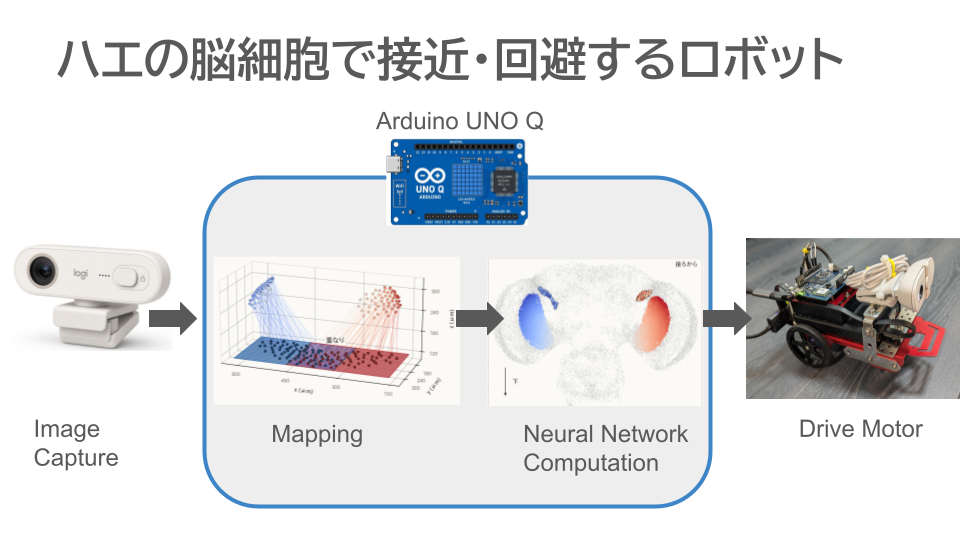
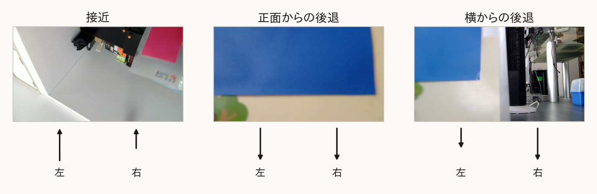
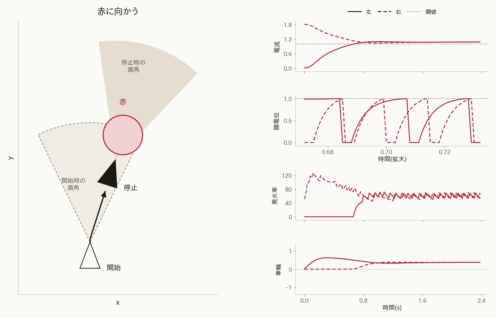
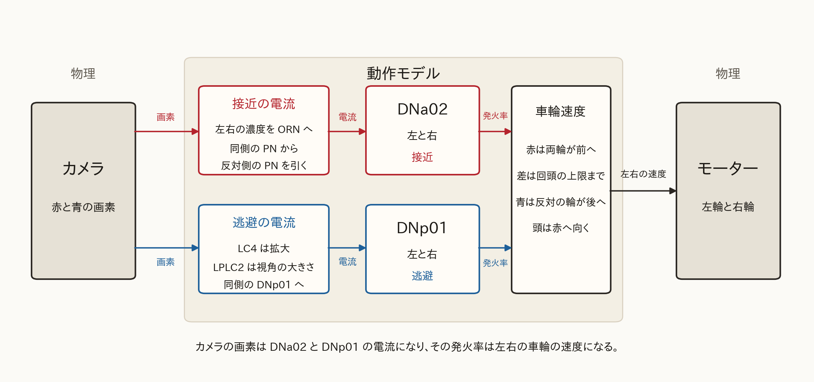

# Fly-Car

コネクトームの細胞を使い、ハエの接近と逃避をロボットで動かす。

[](https://www.youtube.com/watch?v=30UnHq7dWzU)

オスのショウジョウバエのコネクトームが与える視覚細胞から下降ニューロンまでの接続と、嗅覚として反応する触角を一つの動作モデルにし、二輪駆動のロボットに載せた。コネクトームは、脳の細胞間の化学シナプスを数えた接続表である（[Berg et al., 2026](https://doi.org/10.1016/j.cell.2026.08.015)）。カメラの赤は誘引物質、青は近づいてくる対象である。式、数値計算、実機の図は [ポスター原稿](poster/poster.md) にある。

## 接近と逃避

画面の片側に赤があると、両輪が前へ出て、赤い側の車輪が遅く、反対の車輪が速い。頭は赤の方を向く。赤が画面の中心に来ると、左右の車輪が同じ速さで前へ出て近づく。画面の片側の青では、反対の車輪が後ろへ出て、頭は青から回避する。正面の青では、両輪が揃って後ろへ出て、車体は青から離れる。



数値計算は、赤に向かう場合、正面の青から遠ざかる場合、横の青から回避する場合の三枚である。各図の左が経路、右が電流、膜電位、発火率、左右の車輪速度である。



確認したのは、このロボットが出した左右の車輪の動きである。床の上の距離へ車輪速度を合わせる作業は、まだ残っている。

## モデル

このシステムは、カメラの画像を、接近の下降ニューロン DNa02、逃避の下降ニューロン DNp01、触角の嗅覚受容ニューロン ORN、同じ受容体が集まる投射ニューロン PN、視葉の LC4 と LPLC2 で処理し、左右のモーターへ出す。



赤は一種類の誘引物質で、左右の眼の範囲を左右の触角の代わりにする。範囲は中央で重なる。各範囲の赤の割合が同側の ORN に入り、PN で飽和する。同側の PN が促進し、反対側の PN が抑制する電流が、同側の DNa02 に入る。赤の画素が画面の端に寄るほど、左右の濃度は大きくなってから PN に渡る。

青は、近づいてくる対象である。各細胞の位置にある青の割合に、LC4 は拡大の強さを、LPLC2 は視角の大きさを掛ける。LPLC2 の項は、視角が広がっているあいだだけ正になる。二つの項の和が、同側の DNp01 の電流になる。重みは、コネクトームで数えた同側の DNp01 への化学シナプス数である。

四本の膜電位は互いにつながらず、同じ漏れ積分発火で求める。前進は左右の DNa02 の発火率の平均である。回頭は左右の濃度の差で、上限がある。片側だけの赤でも両輪は前へ出る。青の発火は反対の車輪を後ろへ動かす。係数は `src/flycar/behavior.py` と `src/flycar/loom.py`、周期は `src/flycar_q/python/config.py` にある。番号つきの式は [ポスター原稿](poster/poster.md) に置いた。

## 必要な環境

### Linux と Python

シミュレーションは Linux 上の Python 3.12 で確認している。使うパッケージは `numpy`、`matplotlib`、`japanize-matplotlib`、`pandas`、`pyarrow`、`pytest`、`jupyter` である。`pandas` と `pyarrow` はコネクトームの切り出しと、結合表を読むノートだけで使う。

### Arduino Uno Q

実機は Arduino Uno Q。OS は Debian 13、Python は 3.13。シミュレーションだけならボードは要らない。

### Web カメラ

目の代わりは Logitech Brio 100。対角視野は製品仕様の 58°、取り込みの既定は 1280×720 である。画角のシミュレーションはこの仕様の数字だけを使い、カメラ本体は要らない。撮影の実験では、給電できる USB ハブの先にカメラを置く。

## Preparation

### リポジトリの clone

```bash
git clone https://github.com/hamling-ling/fly-car.git
cd fly-car
```

### Python 環境のセットアップ

```bash
python3 -m pip install numpy matplotlib japanize-matplotlib pandas pyarrow pytest jupyter
```

パッケージ `flycar` は `src/flycar` にある。`pytest` は `pyproject.toml` の `pythonpath` でそこを読む。ノートは同じ `src` を `sys.path` に足す。

### コネクトームの切り出し

結合表の入手、NeuPrint からの取り直し、loom 回路と DNa02 回路の切り出し、LC4 と LPLC2 の画面対応は [scripts/README.md](scripts/README.md) に書いた。画角のシミュレーションと `pytest` は、この表が無くても動く。

## Quick Start

### シミュレーションを動かす

リポジトリ直下で、車輪の固定フレームと基準の画角を確認する。

```bash
python3 -m pytest tests/test_behavior.py tests/test_fov.py
```

絵を見るときは `research/notebooks/fov_sim.ipynb` を開く。球の位置を変えるのは `research/notebooks/fov_scenes.ipynb`。どちらもコネクトームの表は読まない。結合そのものを積分するのは `research/notebooks/gf_loom_sim.ipynb` と `research/notebooks/chemotaxis_sim.ipynb` で、先に [切り出し](scripts/README.md) を済ませる。

ノートはリポジトリ直下か `research/notebooks/` から開く。

### 実機で動かす

本番のアプリは `src/flycar_q/`。起動は [src/flycar_q/README.md](src/flycar_q/README.md)。カメラのフレームは `COUNT_S` ごとに読み、膜は `TICK_S` ごとに `Plant.steps` を呼んでパルスをマイコンへ送る。二つの定数は `src/flycar_q/python/config.py` にある。赤は左右の眼の範囲の濃度、青は視角と拡大にする。色の範囲は `src/flycar/color_thresholds.json` にあり、`occupancy.py` が読む。`research/color_capture_q/fit_thresholds.py` が色紙の4点からこのファイルを書く。床での走行と、m/s からパルスへの倍率は、まだ合わせていない。ラジコンとモーターの確認は `research/` に残してある。マイコンへ渡す左右の指令をその場で入れるアプリは [research/motor_adjust/README.md](research/motor_adjust/README.md)。直進に揃えた上限、マイコンへ送った指令、前進と後退の生値は [research/notebooks/straight_limits.ipynb](research/notebooks/straight_limits.ipynb)。ラジコンのページでは、その折れ線を右から左への変換としてオンにできる。`src/flycar_q` は送信直前に、同じ折れ線で左の指令を置き換える。

## 内容物

### シミュレーション

| 場所 | 内容 |
|---|---|
| `src/flycar/behavior.py` | 左右の眼の赤の濃度と、青の視角・拡大から、左右の車輪速度。膜と車輪の刻みはファイルの先頭 |
| `src/flycar/loom.py` | 青の領域から、LC4 と LPLC2 を経て DNp01 の電流を出す |
| `src/flycar/occupancy.py` | カメラ画像の赤と青を、中央で重なる左右の眼の範囲で数える。色の範囲は隣の `color_thresholds.json` |
| `src/flycar/pulse.py` | 車輪の m/s をサーボのパルスにする |
| `src/flycar/fov.py` | 地面の球をカメラへ投影し、車を進める |
| `src/flycar/view.py` | 俯瞰、カメラ、ニューロンの図 |
| `research/notebooks/fov_sim.ipynb` | 基準の 1 場面 |
| `research/notebooks/fov_scenes.ipynb` | 球の位置を変えた場面 |
| `research/notebooks/gf_loom_sim.ipynb` | loom 回路の結合と DNp01 |
| `research/notebooks/chemotaxis_sim.ipynb` | 赤と青の机上走行。車輪則はノート側に別にある |
| `poster/poster.md` | 動作モデルの式、数値計算、実機 |
| `tests/` | 固定フレームと基準場面 |

### 実機を使ったキャプチャの実験

Uno Q に Brio 100 を載せて 1 枚取る手順は [research/camera_capture_q/README.md](research/camera_capture_q/README.md)。スクリプトは `research/camera_capture_q/capture.py`。色の見本をボタンでフォルダに分けるアプリは [research/color_capture_q/README.md](research/color_capture_q/README.md)。

### 本番の車

| 場所 | 内容 |
|---|---|
| `src/flycar_q/` | Uno Q に載せるアプリ。カメラ、膜、車輪 |
