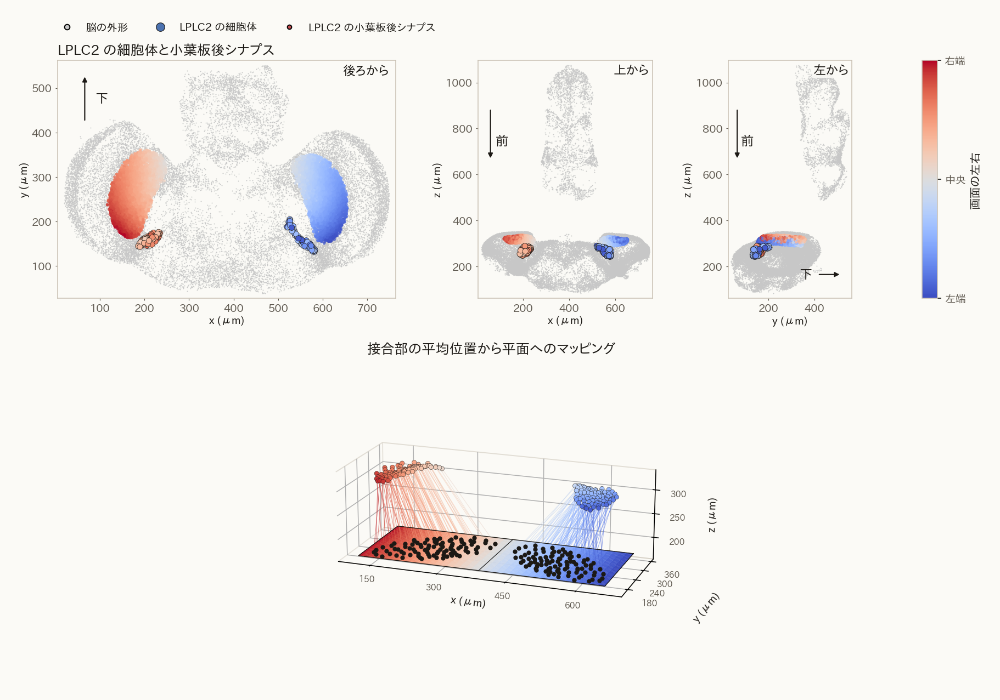
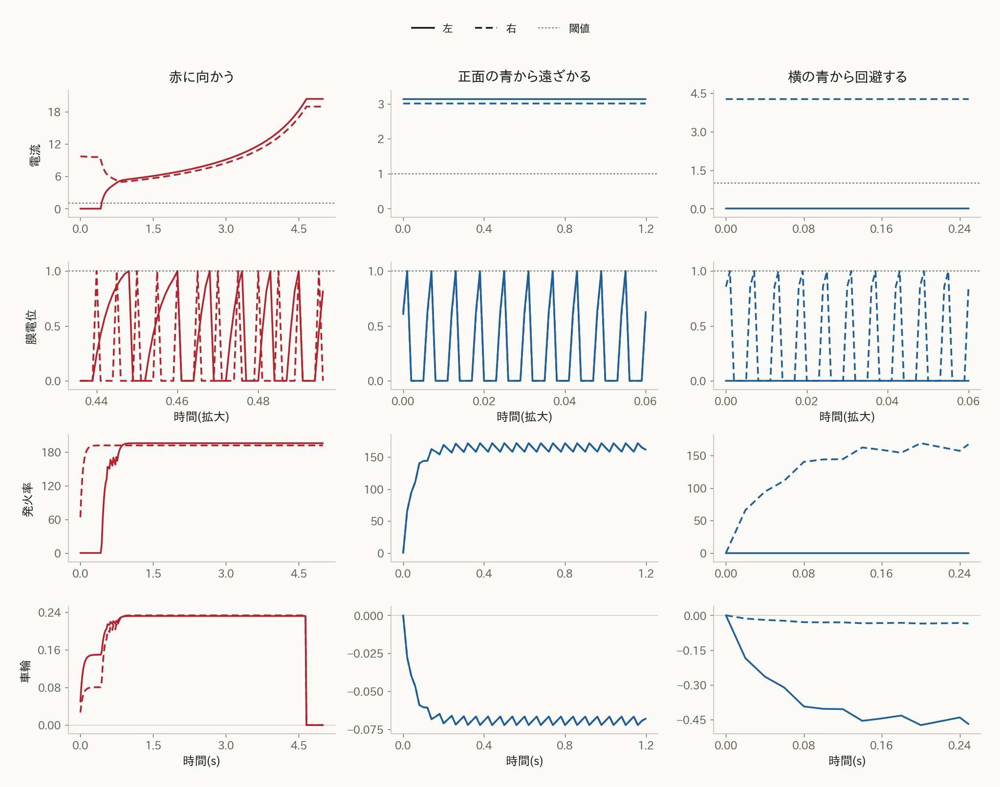
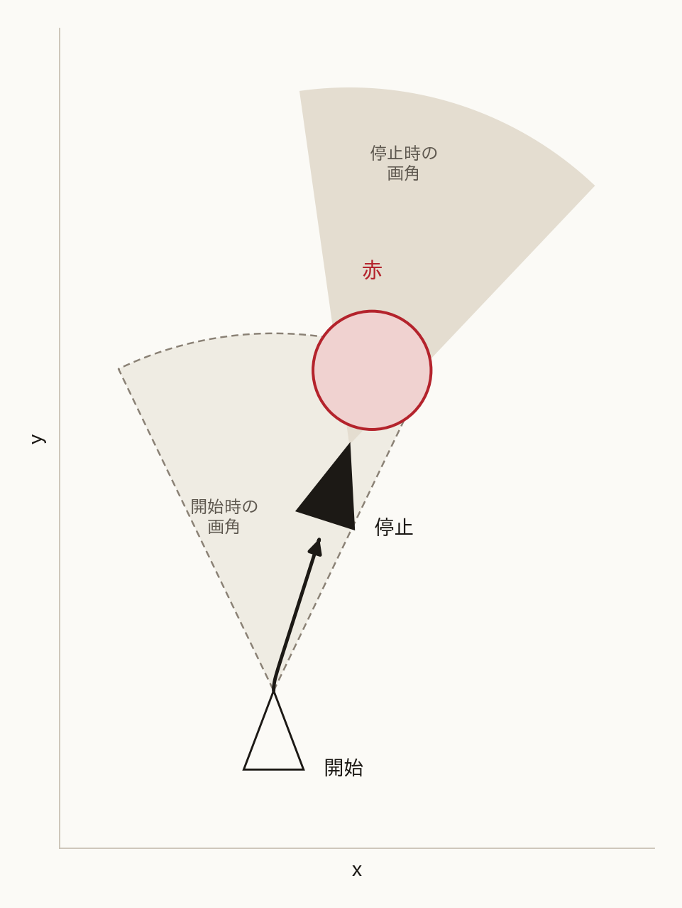
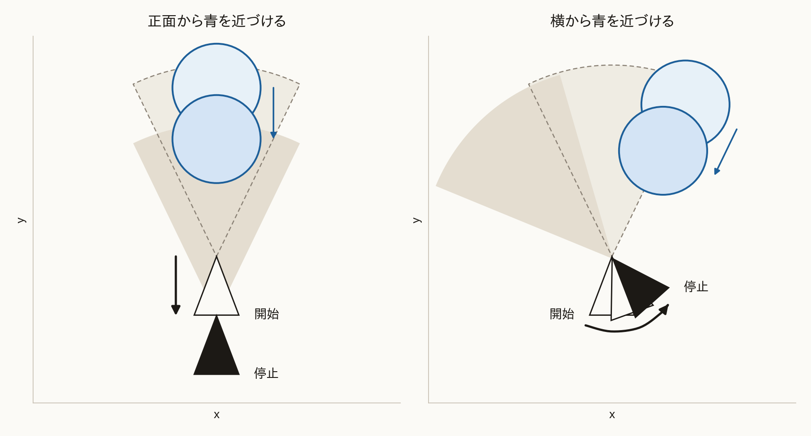

# コネクトームの細胞を用いたハエの接近と逃避のロボット動作モデル

## 要旨

コネクトームの細胞を使い、ハエの接近と逃避をロボットで動かす動作モデルを開発した。コネクトームは、脳の細胞間の化学シナプスを数えた接続表である（Berg et al., 2026）。コネクトームが与える視覚細胞から下降ニューロンまでの接続と、嗅覚として反応する触角を合わせてモデル化し、二輪駆動ロボットに適用した。このロボットはカメラ画像の特定の色の画素をもとに下降ニューロンの膜電位を計算し、発火率を左右の車輪の速度にして接近と逃避を実現する。

カメラから入力される画像の赤は接近の DNa02 の電流になり、青は逃避の DNp01 の電流になる。画像中の赤色を誘引物質として、左右触角でのセンシング結果を、画面の左半分と右半分の赤に代える。各半画面での赤の広がりを平均し、その側の触角が応答した誘引物質の濃度とする。濃度は同側の嗅覚受容ニューロン ORN に入り、同じ受容体が集まる投射ニューロン PN で飽和する。同側の PN が促進し、反対側の PN が抑制する電流が、同側の DNa02 に入る。画面の青は近づいてくる対象である。各細胞が見ている範囲での青の広がりに、LC4 は拡大の強さを、LPLC2 は視角の大きさを乗じて計算する。LPLC2 の項は、視角が広がっているときだけ正になる。二つの項の和が、同側の DNp01 の電流になる。

コネクトームとハエの生物学的性質に基づいたモデルを組み込んだロボットを製作し、次のように接近と逃避動作が可能であることを確認した。画面片側の赤による下降ニューロンの発火は反対側の車輪を前へ動かすことで、車体は赤の方を向く。赤が画面中心に来ることで、両輪が前に動き接近する。画面片側の青による発火は、反対の車輪を後ろに動かし、頭が青から回避する動作を行う。正面の青では、両輪が揃って後ろに動くことで、車体が青から離れる逃避動作となる。

## 全体

接近の膜電位は左右の DNa02、逃避の膜電位は左右の DNp01 である。四本は互いにつながらず、それぞれの電流から膜電位を求める。赤は一種類の誘引物質で、画面の左半分と右半分を左右の触角の代わりにする。各半分の濃度が同側の ORN に入り、同側の PN が促進し、反対側の PN が抑制する電流が、同側の DNa02 に入る。青の LC4 は拡大を、青の LPLC2 は視角の大きさを、同側の DNp01 の電流にする。

## 構造

画素に対応する LC4 の細胞体は、小葉と LC4 の接合部が含まれるマス目 $(a, b)$ から推定した。画面上の位置は、そのマス目の平均位置である。 $a$ が大きいほど眼の外側で、左眼の $a$ の最大が画面の左端、両眼の $a$ の最小が中央、右眼の $a$ の最大が右端になる。 $b$ が小さいほど上である。LPLC2 の画面上の位置も同様に、接合部が含まれるマス目 $(a, b)$ の平均である。使う接合部は小葉板で、マス目の向きは LC4 と同じである。

上段は、LC4 の細胞体と、小葉のマス目に含まれる接合部を同じ脳の上に置いたものである。色は、その推定で決めた画面上の位置で、青が左端、赤が右端である。下段は、接合部の平均位置から手前の平面へ下ろした線である。平面上の黒点が、マス目 $(a, b)$ の平均で決めた画面上の位置に対応する。

続く図は LPLC2 である。LPLC2 の位置も LC4 と同様に、小葉板と LPLC2 の接合部が含まれるマス目 $(a, b)$ から推定した。上段は、LPLC2 の細胞体と、小葉板のマス目に含まれる接合部を同じ脳の上に置いたものである。色は、その推定で決めた画面上の位置で、青が左端、赤が右端である。下段は、接合部の平均位置から手前の平面へ下ろした線である。平面上の黒点が、マス目 $(a, b)$ の平均で決めた画面上の位置に対応する。

## モデル方程式

構造をモデル方程式にした。本章では、接近と逃避を行うその式を説明する。このモデルにより、カメラ画像の赤と青の画素からモーターへの入力を得る。

### 画素の広がり

左右のそれぞれの視野はほぼ $180^\circ$ で、正面で重なる（Borst, 2009）。重なりの幅は文献によって異なり、前方で個眼数個とするものから（Heisenberg and Wolf, 1984）、方位およそ $23^\circ$ とするものまである（Kemppainen et al., 2022）。そのため、右寄りの方向も左の視野に入る。画面を中央で分けると、その色は片方にしか入らない。青では、この重なりを、目的色を周りへ広げることで簡単に表す。この広がりは目的色の周りの画素すべてに付き、赤の濃度にも同じ $a(x)$ を使う。目的色の画素を 1 とする。画素 $x$ から一番近い、その色の画素までの距離を $d(x)$ とする。距離は、画素数を画像の横幅で割った長さで、縦も横幅を単位にする。 $\sigma_d$ はその広がりである。広がり $a(x)$ を式 (1) で表す。その色の画素では $d(x) = 0$ なので $a(x) = 1$ のままである。

$$
a(x)=\exp\left(-\frac12\left(\frac{d(x)}{\sigma_d}\right)^2\right)
\tag{1}
$$

### 接近の電流

嗅覚によってハエの好む物質を感じ取り、その方向に接近する処理を表す。ハエは触角によって臭いを検出する。触角の受容体が臭いの分子に反応すると、ORN（Olfactory Receptor Neuron：嗅覚受容ニューロン / 嗅覚感覚神経細胞）が活性化する。同じ受容体の ORN は、触角ごとに一つの糸球体へ収束する（Vosshall et al., 2000）。この節では臭いの刺激が下降ニューロンにまで伝達するまでの流れを数式化する。

左右の触角が感じ取る臭い分子の濃度は、左右の半分画面での赤色画素の濃度として捉える。 $H_L$ と $H_R$ を、付録の $p$ が $1/2$ 未満の画素と $1/2$ 以上の画素の集合、 $|H_L|$ と $|H_R|$ を画素数と置いて、左右の触角が受ける臭いの濃度 $c_{L,R}$ は式 (2) で表される。式 (2) では、端にある赤は、反対側への広がり $a(x)$ が小さいので、左右の濃度の差が大きい。中央に近い赤は両側へ漏れるので、差は小さい。右半分の左端が赤なら、左半分の右端でも $a(x)$ は正になる。

$$
c_{L,R}=\frac{\sum_{x \in H_{L,R}} a(x)}{|H_{L,R}|}
\tag{2}
$$

PN の出力 $u^{\mathrm{PN}}_{L,R}$ は、一つの触角に収束した濃度を 0 から 1 へ飽和させたものである。一つの触角では、ORN は位置で分けず、同じ濃度を受ける。濃度が高いほど ORN の発火率は上がる。飽和により、この出力は 1 を超えない。 $n$ はその触角にある ORN の数で、画素数ではない。 $c_0$ は飽和の定数である（Bhandawat et al., 2007; Olsen and Wilson, 2008）。

$$
u^{\mathrm{PN}}_{L,R}=\frac{n c_{L,R}}{n c_{L,R}+c_0}
\tag{3}
$$

左の DNa02 の電流 $I^{\mathrm{DNa02}}_{L}$ は、同側の PN から、反対側の PN の $\beta$ 倍を引いたものである。 $\beta$ は反対側からの抑制の係数で、0 から 1 の値をとる。左右を比べることで、どちら側が濃いかがこの電流に現れる。 $\alpha$ は発火率を電流の大きさに合わせる係数で、逃避の電流で定める。反対側が大きい側の電流は負になり、その膜電位は下がる。

$$
I^{\mathrm{DNa02}}_{L}=\alpha\left(u^{\mathrm{PN}}_{L}-\beta u^{\mathrm{PN}}_{R}\right)
\tag{4}
$$

右の DNa02 の電流 $I^{\mathrm{DNa02}}_{R}$ は、左右を入れ替えた同じ引き算である。同側は右の PN、反対側は左の PN である。 $\alpha$ と $\beta$ は左と同じである。

$$
I^{\mathrm{DNa02}}_{R}=\alpha\left(u^{\mathrm{PN}}_{R}-\beta u^{\mathrm{PN}}_{L}\right)
\tag{5}
$$

### 逃避の電流

逃避は、一番大きい青の領域の視角 $\theta$ と、その拡大 $\dot\theta=d\theta/dt$ を電流にする。 $\theta$ は、青の領域がカメラの対角の中で占める角度である。計算は付録に置く。DNp01 の電流は、LC4 の拡大と LPLC2 の大きさの和である。

$s(\dot\theta)$ は拡大の強さで、LC4 の項に掛ける。 $m$ はシグモイドの中心、 $w$ はその幅である。指数に掛かる $1/w$ がゲインである。 $k_s$ は調節用の係数である。 $g(\theta)$ は視角の大きさで、LPLC2 の項に掛ける。視角が広がっているときだけ正で、止まっているときと遠ざかっているときは 0 である。

$$
s(\dot\theta)=k_s \frac{1}{1+\exp\left(-\dfrac{1}{w}(\dot\theta-m)\right)}
\tag{6}
$$

青では、 $d(x)$ を一番近い青の画素までの距離とし、 $a(x)$ を刺激の値にする。細胞 $i$ が見ている画素の集合を $X_i$ とする。 $|X_i|$ はその画素数である。 $f_i$ は、その集合での $a(x)$ の平均である。 $w_i$ は、その細胞から同側の DNp01 への化学シナプス数である（Berg et al., 2026）。LC4 と LPLC2 で、それぞれの $w_i$ を使う。 $`W^{\mathrm{LC4}}_{\mathrm{side}}`$ と $`W^{\mathrm{LPLC2}}_{\mathrm{side}}`$ は、その種類の、その側の $w_i$ の和である。和は、その種類の細胞について取る。右半分の左端が青なら、左半分の右端でも $a(x)$ は正になり、左の LC4 と左の LPLC2 が刺激される。

$$
f_i=\frac{\sum_{x \in X_i} a(x)}{|X_i|}
\tag{7}
$$

$$
F^{\mathrm{LC4}}_{L,R}
=\frac{\sum_i w_i f_i}{W^{\mathrm{LC4}}_{\mathrm{side}}}
\tag{8}
$$

$$
F^{\mathrm{LPLC2}}_{L,R}
=\frac{\sum_i w_i f_i}{W^{\mathrm{LPLC2}}_{\mathrm{side}}}
\tag{9}
$$

LC4 の発火率は、その細胞が見ている範囲での青の広がりの平均に、拡大の強さを掛けたものである。LPLC2 の発火率は、その細胞が見ている範囲での青の広がりの平均に、視角の大きさを掛けたものである。平均も強さも 1 のとき、発火率は最大値 $r_{\max}$ になる。膜の閾値は 1 である。平均が 1 で、発火率が $r_{\mathrm{ref}}$ のとき、その項の電流は 1 になる。この変換の係数は $r_{\max}/r_{\mathrm{ref}}$ で、式 (10) の $\alpha$ がこれである。

$$
\alpha = \frac{r_{\max}}{r_{\mathrm{ref}}}
\tag{10}
$$

$$
I^{\mathrm{DNp01}}_{L,R}
=\alpha\left(s(\dot\theta) F^{\mathrm{LC4}}_{L,R}+g(\theta) F^{\mathrm{LPLC2}}_{L,R}\right)
\tag{11}
$$

### 膜

膜は四本とも同じ積分発火である。 $V$ は膜電位で、閾値は 1 とする。 $V \ge 1$ でスパイクし、 $V$ を 0 に戻す。 $\tau_{\mathrm{ref}}$ は不応期で、そのあいだは $V$ を 0 のままにする。 $s_{\mathrm{spk}}$ はスパイクの有無で、スパイクした刻みだけ 1、それ以外は 0 である。 $\Delta t$ は刻み幅、 $\tau$ は膜の時定数、 $I$ はその膜の電流である。

$$
V \leftarrow V + \frac{\Delta t}{\tau}(-V + I)
\tag{12}
$$

$r$ は発火率、 $\tau_r$ はその時定数である。

$$
r \leftarrow r + \frac{\Delta t}{\tau_r}\left(-r + \frac{s_{\mathrm{spk}}}{\Delta t}\right)
\tag{13}
$$

### 車輪

四本の発火率は、反対側の車輪への指令になる。左の指令は右の DNa02 と右の DNp01 を見、右の指令は左の二つを見る。赤の発火率は車輪を前へ動かし、青の発火率は車輪を後へ動かす。 $u_L$ と $u_R$ は左右の指令である。 $k$ は、発火率の差を指令にする係数である。赤と青は、この同じ $k$ で入る。

$$
u_L = k\left(r^{\mathrm{DNa02}}_R - r^{\mathrm{DNp01}}_R\right)
\tag{14}
$$

$$
u_R = k\left(r^{\mathrm{DNa02}}_L - r^{\mathrm{DNp01}}_L\right)
\tag{15}
$$

$\tau_v$ は指令をならす時定数である。 $v_L$ と $v_R$ は、ならしたあとの左右の車輪速度である。 $\Delta t$ は膜の刻み幅である。

$$
v_L \leftarrow v_L + \frac{\Delta t}{\tau_v}(-v_L + u_L)
\tag{16}
$$

$$
v_R \leftarrow v_R + \frac{\Delta t}{\tau_v}(-v_R + u_R)
\tag{17}
$$

片側だけが赤のとき、赤い側の DNa02 が残り、赤い側の車輪は止まり、反対の車輪が前へ出る。鼻は赤のほうを向く。止まった車輪を中心に回るので、旋回半径は左右の車輪の間隔の半分である。正面に近い赤ほど左右の PN の差は小さく、その車輪の速さも小さい。左右の PN が等しいとき、各側の電流は、その PN の $\alpha(1-\beta)$ 倍である。 $\beta = 1$ では両方の電流が 0 になり、車輪は止まる。 $\beta < 1$ では、両輪が同じ速さで前へ出る。

片側だけが青のとき、青と反対の車輪が後へ出て、青い側の車輪は止まる。鼻は青と反対を向く。進行は後ろなので、車体は青のある側へ下がる。左右の青がそろって発火すると、両輪が同じ速さで後へ出て、車体はまっすぐ下がる。

## 数値計算

三つの場合について、膜に入る電流、膜電位、発火率、左右の車輪速度を時間で並べる。車輪は、一方の細胞だけが発火しているときを 1 として正規化してある。前が正である。車輪速度は指令を $\tau_v$ でならしたもので、発火率に残る細かい凹凸は持たない。実線が左、破線が右、点線は膜の閾値である。赤へ向かうときは DNa02、青のときは DNp01 である。青の二つは、視角と拡大を保ったときの電流である。膜電位の横軸は、発火が続いている区間を拡大したものである。スパイクは数ミリ秒で、閾値に達すると 0 に戻り、不応期のあいだ 0 のままである。右にある赤では、右の電流が残り、左の車輪が前へ出て右の車輪は止まる。左右の差が小さくなると、電流も小さくなる。正面の青では左右がそろって発火し、両輪が同じ速さで後へ出る。横の青では青い側だけが発火し、反対の車輪が後へ出て、青い側の車輪は止まる。

## 接近

片側に赤い目標があると、赤い側の車輪は止まり、反対の車輪が前へ出て、そちらへ曲がる。左右の PN が等しく $\beta = 1$ のとき、車輪は止まる。

## 逃避

正面から青が近づくと、両輪がそろって後退する。横から青が近づくと、青から離れる向きに回りながら、反対の車輪がより強く後退する。

## 実機

三枚は、実機のカメラの画像である。矢印は、そのときの左右の車輪の駆動方向で、上が前、下が後ろである。長い矢印は、より強く動いた車輪である。

## 付録　視角 $\theta$ の計算

$\theta$ は、一番大きい青の領域がカメラから見て占める角で、両端のあいだを測る。領域の画素を同じ面積の円に直し、カメラの位置からその円を見込んだ角が $\theta$ である。画面全体の画角とは別で、領域の中心が向いている方向でもない。

画面は対角 $\delta = 58^\circ$ 、縦横比 $16/9$ である。カメラの前方、距離 1 の平面にこの画面を置く。左右の半幅の正接を $t_h$ 、上下の半高の正接を $t_v$ とすると、式 (18) を満たす。

$$
\sqrt{t_h^2 + t_v^2} = \tan(\delta/2), \qquad t_h = \frac{16}{9} t_v
\tag{18}
$$

画素 $(p, q)$ は 0 から 1 で、 $p$ は左から右、 $q$ は上から下にとる。距離 1 の平面では式 (19) の位置になる。

$$
n_x = (2p - 1) t_h, \qquad n_y = (1 - 2q) t_v
\tag{19}
$$

一番大きい領域の画素数を $N$ 、画像の横と縦の画素数を $W_{\mathrm{px}}$ 、 $H_{\mathrm{px}}$ とする。その画素を平面に置いた面積を $A$ 、同じ面積の円の半径を $R$ とする。中心の平面座標を $(\bar n_x, \bar n_y)$ 、カメラからその中心までの距離を $D$ とする。

$$
A = N \cdot \frac{2 t_h}{W_{\mathrm{px}}} \cdot \frac{2 t_v}{H_{\mathrm{px}}}, \qquad R = \sqrt{A/\pi}
\tag{20}
$$

$$
D = \sqrt{1 + \bar n_x^2 + \bar n_y^2}, \qquad \theta = 2\arctan(R/D)
\tag{21}
$$

中心が画面の真ん中なら $D = 1$ である。この $\delta$ では、左右の端から端は約 $52^\circ$ 、上下の端から端は約 $30^\circ$ になる。

## 文献

Berg, S., Beckett, I. R., Costa, M., et al. (2026). Sexual dimorphism in the complete Drosophila male central nervous system connectome. Cell, 189(18), 5504–5526.e15. https://doi.org/10.1016/j.cell.2026.08.015

Bhandawat, V., Olsen, S. R., Gouwens, N. W., Schlief, M. L., and Wilson, R. I. (2007). Sensory processing in the Drosophila antennal lobe increases reliability and separability of ensemble odor representations. Nature Neuroscience, 10(11), 1474–1482. https://doi.org/10.1038/nn1976

Borst, A. (2009). Drosophila's view on insect vision. Current Biology, 19(1), R36–R47. https://doi.org/10.1016/j.cub.2008.11.001

Heisenberg, M. and Wolf, R. (1984). Vision in Drosophila: Genetics of Microbehavior. Springer, Berlin. https://doi.org/10.1007/978-3-642-69936-8

Kemppainen, J., Scales, B., Razban Haghighi, K., et al. (2022). Binocular mirror-symmetric microsaccadic sampling enables Drosophila hyperacute 3D vision. Proceedings of the National Academy of Sciences, 119(12), e2109717119. https://doi.org/10.1073/pnas.2109717119

Olsen, S. R. and Wilson, R. I. (2008). Lateral presynaptic inhibition mediates gain control in an olfactory circuit. Nature, 452(7190), 956–960. https://doi.org/10.1038/nature06864

Vosshall, L. B., Wong, A. M., and Axel, R. (2000). An olfactory sensory map in the fly brain. Cell, 102(2), 147–159. https://doi.org/10.1016/S0092-8674(00)00021-0
