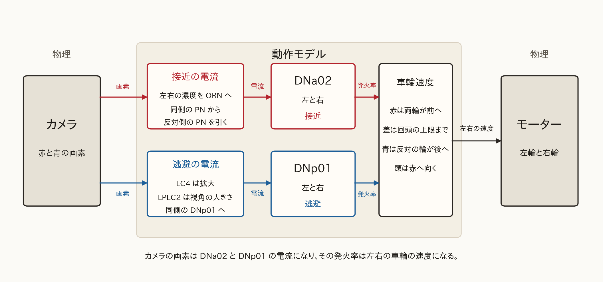
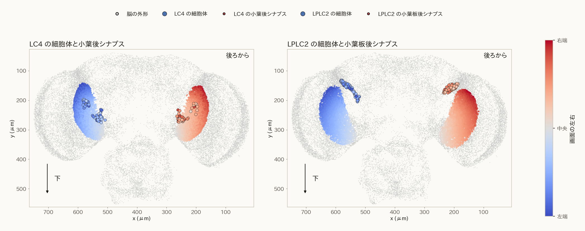
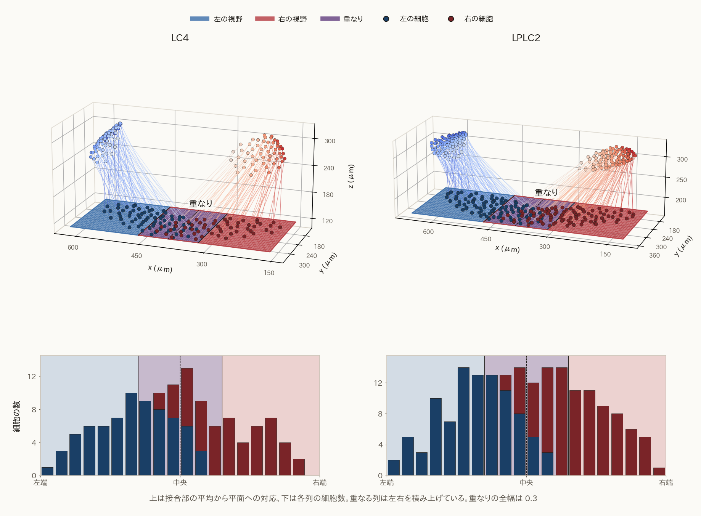
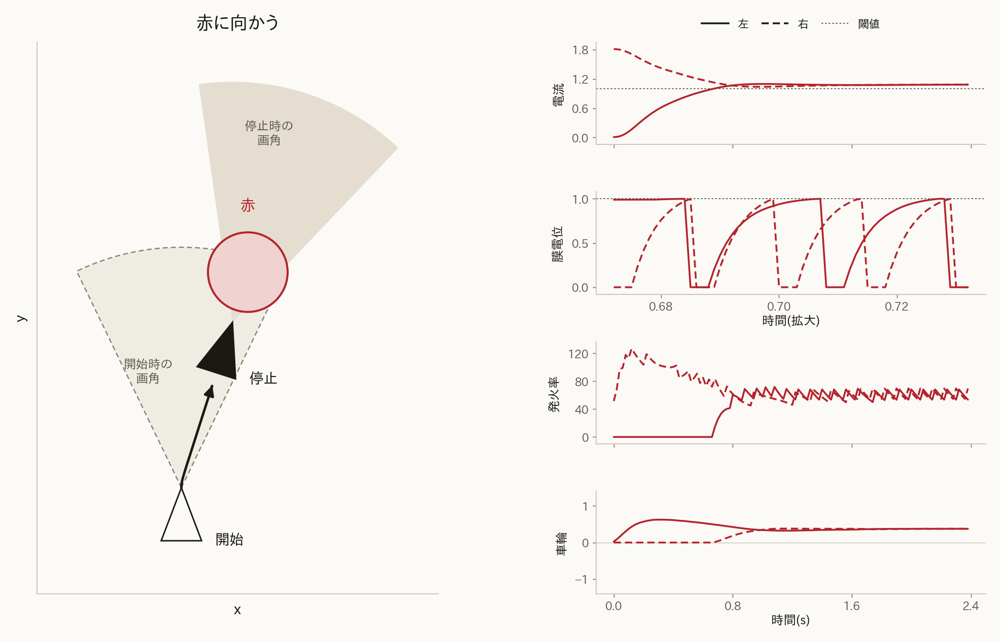
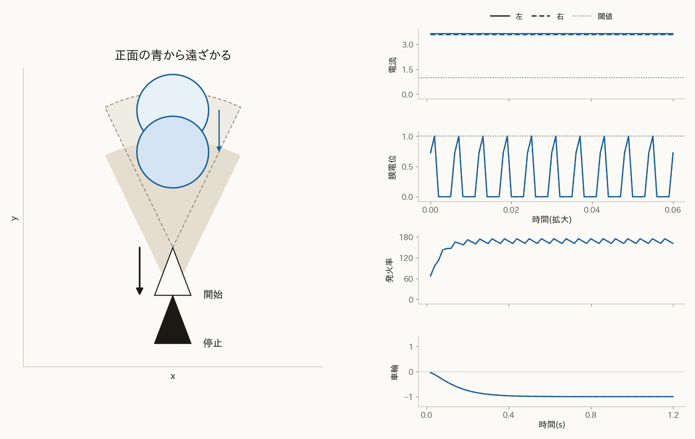
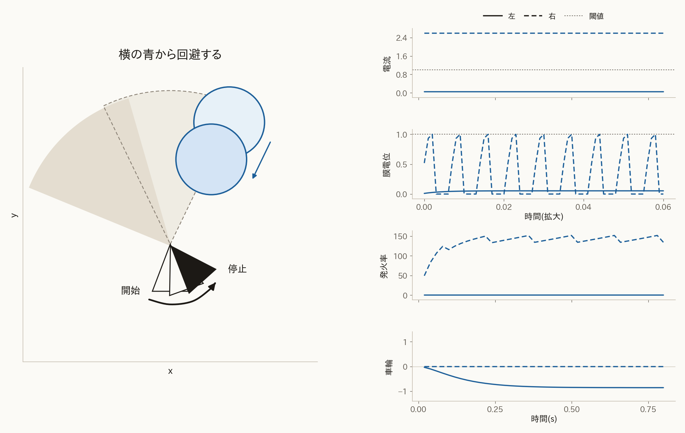
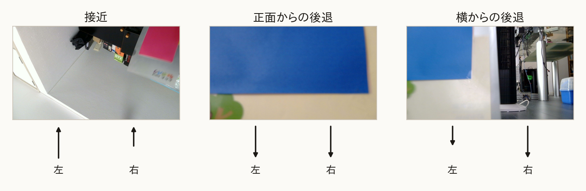
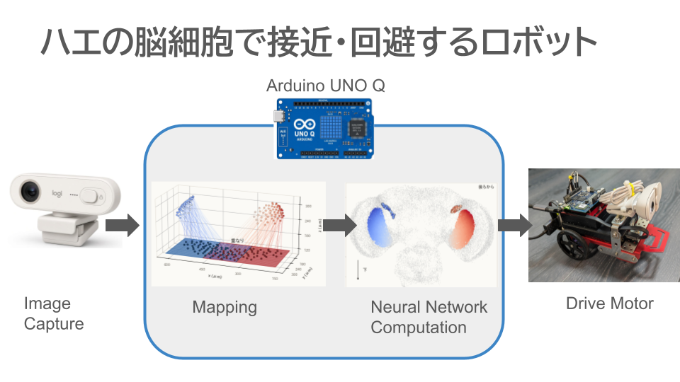

# コネクトームの細胞を用いたハエの接近と逃避のロボット動作モデル

## 要旨

コネクトームの細胞を使い、ハエの接近と逃避をロボットで動かす動作モデルを開発した。コネクトームは、脳の細胞間の化学シナプスを数えた接続表である（Berg et al., 2026）。コネクトームが与える視覚細胞から下降ニューロンまでの接続と、嗅覚として反応する触角を合わせてモデル化し、二輪駆動ロボットに適用した。このロボットはカメラ画像の特定の色の画素をもとに下降ニューロンの膜電位を計算し、発火率を左右の車輪の速度にして接近と逃避を実現する。

カメラから入力される画像の赤は接近の DNa02 の電流になり、青は逃避の DNp01 の電流になる。画像中の赤色を誘引物質として、左右触角でのセンシング結果を、左右の眼の範囲の赤に代える。各範囲の赤の割合を平均し、その側の触角が応答した誘引物質の濃度とする。濃度は同側の嗅覚受容ニューロン ORN に入り、同じ受容体が集まる投射ニューロン PN で飽和する。同側の PN が促進し、反対側の PN が抑制する電流が、同側の DNa02 に入る。画面の青は近づいてくる対象である。各細胞の位置にある青の割合に、LC4 は拡大の強さを、LPLC2 は視角の大きさを乗じて計算する。LPLC2 の項は、視角が広がっているときだけ正になる。二つの項の和が、同側の DNp01 の電流になる。

コネクトームとハエの生物学的性質に基づいたモデルを組み込んだロボットを製作し、次のように接近と逃避動作が可能であることを確認した。画面片側の赤による下降ニューロンの発火は、両輪を前へ動かし、赤い側の車輪を遅く、反対の車輪を速くすることで、頭は赤の方を向く。赤が画面中心に来ると、左右の車輪が同じ速さで前へ出て接近する。画面片側の青による発火は、反対の車輪を後ろに動かし、頭が青から回避する動作を行う。正面の青では、両輪が揃って後ろに動くことで、車体が青から離れる逃避動作となる。

## 全体

このシステムは、カメラからの画像を入力とし、接近の下降ニューロン DNa02、逃避の下降ニューロン DNp01、触角の嗅覚受容ニューロン ORN、同じ受容体が集まる投射ニューロン PN、視葉の視覚細胞 LC4 と LPLC2 によって構成される動作モデルで処理し、左右のモーターへ動力を出力する。接近の膜電位は、左右の DNa02 が持つ。DNa02 は、接近の指令を脳から体へ下ろす下降ニューロンである。逃避の膜電位は、左右の DNp01 が持つ。DNp01 は、逃避の指令を下ろす下降ニューロンである。四本は互いにつながらず、それぞれの電流から膜電位を求める。赤は一種類の誘引物質で、左右の眼の範囲を左右の触角の代わりにする。範囲は中央で重なる。各範囲の濃度が同側の ORN に入る。ORN は、触角で臭い分子を受ける嗅覚受容ニューロンである。同じ受容体の ORN が集まる投射ニューロンが PN で、同側の PN が促進し、反対側の PN が抑制する電流が、同側の DNa02 に入る。青では、視葉の視覚細胞のうち、拡大を担う LC4 と、視角の大きさを担う LPLC2 が、同側の DNp01 の電流になる。

## 構造

2次元のカメラ画像を、ハエの左右の目として扱う。そのために、関係する LC4 と LPLC2 が視葉のどこにあるかを示し、その位置から各細胞の画面上の位置を推定して、画面へ射影する。

視葉の小葉と小葉板は、視野の向きごとにマス目へ分かれている。一つのマス目は視野の一つの向きに対応し、コネクトームの各後シナプスには、その後シナプスが乗るマス目の番号 $(a, b)$ が付いている（Berg et al., 2026）。LC4 は小葉のマス目を、LPLC2 は小葉板のマス目を使う。

画素に対応する LC4 の細胞体は、小葉と LC4 の接合部が含まれるマス目から推定した。画面上の位置は、そのマス目の平均位置である。 $a$ が大きいほど眼の外側で、左眼のマス目全体での $a$ の最大が画面の左端、両眼の $a$ の最小が中央、右眼のマス目全体での $a$ の最大が右端になる。 $b$ が小さいほど上である。LPLC2 の画面上の位置も同様に、接合部が含まれるマス目の平均である。向きは LC4 と同じである。

図は、後ろから見た LC4 と LPLC2 である。図の右がハエの右眼、上が背側である。LC4 は細胞体と、小葉のマス目に含まれる接合部を示す。LPLC2 は細胞体と、小葉板のマス目に含まれる接合部を示す。色は、その推定で決めた画面上の位置で、青が左端、赤が右端である。

ハエの視野は左右のそれぞれのほぼ $180^\circ$ で、正面で重なることが知られている（Borst, 2009）。重なりの幅は文献によって異なり、前方で個眼数個とするものから（Heisenberg and Wolf, 1984）、方位およそ $23^\circ$ とするものまである（Kemppainen et al., 2022）。そのため、右寄りの方向も左の視野に入るべきであり、画面を中央で分けると、その色は片方にしか入らないため、左右の目に対応する画面を真ん中で分割せず、重なりを持って分割する。

次の図は、外側を固定して各眼の範囲を中央の向こうまで広げたあとの、接合部の平均位置と画面上の位置の対応である。上は接合部の平均位置から平面へ下ろした線、下は各列に入った細胞の数で、重なる列は左右を積み上げている。左が LC4、右が LPLC2 である。重なりの全幅は画面幅の 0.3 である。

## モデル方程式

構造をモデル方程式にした。本章では、接近と逃避を行うその式を説明する。このモデルにより、カメラ画像の赤と青の画素からモーターへの入力を得る。

### 視野の重なり

構造で定めた左右の範囲を定式化する。画素の左右の位置 $p$ は付録と同じで、左端が 0、右端が 1 である。左の範囲 $H_L$ と右の範囲 $H_R$ は式 (1) である。

$$
H_L=\lbrace x \mid 0 \le p \le 0.65\rbrace, \qquad H_R=\lbrace x \mid 0.35 \le p \le 1\rbrace
\qquad (1)
$$

### 接近の電流

嗅覚によってハエの好む物質を感じ取り、その方向に接近する処理を表す。ハエは触角によって臭いを検出する。触角の受容体が臭いの分子に反応すると、ORN（Olfactory Receptor Neuron：嗅覚受容ニューロン / 嗅覚感覚神経細胞）が活性化する。同じ受容体の ORN は、触角ごとに一つの糸球体へ収束する（Vosshall et al., 2000）。この節では臭いの刺激が下降ニューロンにまで伝達するまでの流れを数式化する。

左右の触角が感じ取る臭い分子の濃度は、式 (1) の範囲にある赤の割合である。赤の画素を 1、それ以外を 0 とし、その値を $r(x)$ と置く。 $|H_L|$ と $|H_R|$ は、その範囲の画素数である。左右の濃度 $c_{L,R}$ は式 (2) で表される。

$$
c_{L,R}=\frac{\sum_{x \in H_{L,R}} r(x)}{|H_{L,R}|}
\qquad (2)
$$

横からの臭いに反応してその方向を向くには、真ん中からの臭いに比べて刺激を強く感じ取り、回頭を大きくする。赤の画素が画面の端に寄るほど、左右の濃度に同じ倍率を掛けてから PN に渡す。画素 $x$ の左右の位置を $p(x)$ とする。これは式 (1) の $p$ と同じで、左端が 0、右端が 1 である。赤の画素の集合を $R=\lbrace x \mid r(x)=1\rbrace$ とする。 $R$ が空のとき、その位置の平均 $\bar p$ は $1/2$ である。空でないときの平均は式 (3) である。

$$
\bar p=\frac{\sum_{x \in R} p(x)}{|R|}
\qquad (3)
$$

中央を 0 にした左右の位置 $\hat p$ は式 (4) である。左端が $-1$、中央が $0$、右端が $1$ である。

$$
\hat p=2\bar p-1
\qquad (4)
$$

倍率は $1+\kappa|\hat p|$ である。 $\kappa$ は 0 以上の係数である。中央では $|\hat p|=0$ なので倍率は 1 で、濃度は式 (2) のままである。端では同じ画素の割合でも濃度は大きくなる。左右に掛ける倍率は同じである。赤の無い側は 0 のままである。PN に渡す濃度 $c'_{L,R}$ は式 (5) である。

$$
c'_{L,R}=(1+\kappa|\hat p|) c_{L,R}
\qquad (5)
$$

PN の出力 $`u^{\mathrm{PN}}_{L,R}`$ は、一つの触角に収束した濃度 $c'$ を 0 から 1 へ飽和させたものである。一つの触角では、ORN は位置で分けず、同じ濃度を受ける。濃度が高いほど ORN の発火率は上がる。飽和により、この出力は 1 を超えない。 $n$ はその触角にある ORN の数で、画素数ではない。左右で一つの値であり、端の倍率は濃度 $c'$ に入っている。 $c_0$ は飽和の定数である（Bhandawat et al., 2007; Olsen and Wilson, 2008）。 $`u^{\mathrm{PN}}_{L,R}`$ は式 (6) で表される。

$$
u^{\mathrm{PN}}_{L,R}=\frac{n c'_{L,R}}{n c'_{L,R}+c_0}
\qquad (6)
$$

左の DNa02 の電流 $I^{\mathrm{DNa02}}_{L}$ は、同側の PN から、反対側の PN の $\beta$ 倍を引いたものである。 $\beta$ は反対側からの抑制の係数で、0 から 1 の値をとる。左右を比べることで、どちら側が濃いかがこの電流に現れる。 $\alpha$ は発火率を電流の大きさに合わせる係数で、逃避の電流で定める。反対側が大きい側の電流は負になり、その膜電位は下がる。この電流は式 (7) で表される。

$$
I^{\mathrm{DNa02}}_{L}=\alpha\left(u^{\mathrm{PN}}_{L}-\beta u^{\mathrm{PN}}_{R}\right)
\qquad (7)
$$

右の DNa02 の電流 $`I^{\mathrm{DNa02}}_{R}`$ は、左右を入れ替えた同じ引き算である。同側は右の PN、反対側は左の PN である。 $\alpha$ と $\beta$ は左と同じである。 $`I^{\mathrm{DNa02}}_{R}`$ は式 (8) で表される。

$$
I^{\mathrm{DNa02}}_{R}=\alpha\left(u^{\mathrm{PN}}_{R}-\beta u^{\mathrm{PN}}_{L}\right)
\qquad (8)
$$

### 逃避の電流

近づいてくる対象から離れる処理を表す。対象が近づくと、その像の視角は広がり、拡大速度を持つ。LC4 は拡大速度を、LPLC2 は視角の大きさを符号化し、巨大線維では両者が足される（Ache et al., 2019）。LPLC2 は、中心から外へ向かう動きに選択的で、収縮にはほとんど応答しない（Klapoetke et al., 2017）。このモデルでは、その和を同側の DNp01 の電流にする。重みは、同側の DNp01 への化学シナプス数である（Berg et al., 2026）。この節では、青の画素からその電流までの流れを数式化する。

LC4 と LPLC2 に入る量は、一番大きい青の領域の視角 $\theta$ とその拡大 $\dot\theta$ である。 $\theta$ は、青の領域がカメラの対角の中で占める角度である。 $\dot\theta=d\theta/dt$ である。計算は付録の式 (24) から式 (27) に置く。

LC4 に掛ける拡大の強さ $s(\dot\theta)$ は、拡大速度が中心を超えると立ち上がるスイッチである。止まった対象や、ごく遅い拡大は、小さいままにする。 $m$ はシグモイドの中心、 $w$ はその幅である。指数に掛かる $1/w$ がゲインである。 $k_s$ は調節用の係数である。この強さは式 (9) で表される。

$$
s(\dot\theta)=k_s \frac{1}{1+\exp\left(-\dfrac{1}{w}(\dot\theta-m)\right)}
\qquad (9)
$$

各細胞の刺激 $f_i$ は、構造で定めた画面上の位置 $p_i$ にある縦一列の、青の割合である。その列の画素の集合を $C(p_i)$ とする。青の画素を 1、それ以外を 0 とし、その値を $b(x)$ と置く。 $f_i$ は式 (10) で表される。

$$
f_i=\frac{\sum_{x \in C(p_i)} b(x)}{|C(p_i)|}
\qquad (10)
$$

LC4 から同側の DNp01 への寄与 $`F^{\mathrm{LC4}}_{L,R}`$ は、シナプス数で重み付けした刺激の平均である。接続の多い細胞ほど、電流への寄与が大きい。 $w_i$ は、その細胞から同側の DNp01 への化学シナプス数である（Berg et al., 2026）。 $`W^{\mathrm{LC4}}_{\mathrm{side}}`$ は、その側の LC4 についての $w_i$ の和である。側ごとの和で割ると、画面を覆ったときの値がシナプスの総数によらない。 $`F^{\mathrm{LC4}}_{L,R}`$ は式 (11) で表される。

$$
F^{\mathrm{LC4}}_{L,R}
=\frac{\sum_i w_i f_i}{W^{\mathrm{LC4}}_{\mathrm{side}}}
\qquad (11)
$$

LPLC2 から同側の DNp01 への寄与 $`F^{\mathrm{LPLC2}}_{L,R}`$ は、同じ平均を LPLC2 自身のシナプス数で重み付けしたものである。大きさの項は、LPLC2 の接続だけで決まる。 $`W^{\mathrm{LPLC2}}_{\mathrm{side}}`$ は、その側の LPLC2 についての $w_i$ の和である。 $`F^{\mathrm{LPLC2}}_{L,R}`$ は式 (12) で表される。

$$
F^{\mathrm{LPLC2}}_{L,R}
=\frac{\sum_i w_i f_i}{W^{\mathrm{LPLC2}}_{\mathrm{side}}}
\qquad (12)
$$

発火率を電流の大きさに合わせる係数 $\alpha$ は、 $r_{\max}/r_{\mathrm{ref}}$ である。LC4 の発火率は、見ている範囲の平均に拡大の強さを掛けたものである。LPLC2 の発火率は、見ている範囲の平均に視角の大きさを掛けたものである。平均も強さも 1 のとき、発火率は最大値 $r_{\max}$ になる。膜の閾値は 1 である。平均が 1 で、発火率が $r_{\mathrm{ref}}$ のとき、その項の電流は 1 になる。この係数は式 (13) である。

$$
\alpha = \frac{r_{\max}}{r_{\mathrm{ref}}}
\qquad (13)
$$

同側の DNp01 の電流 $I^{\mathrm{DNp01}}_{L,R}$ は、LC4 の拡大の項と LPLC2 の大きさの項の和に、 $\alpha$ を掛けたものである。 $g(\theta)$ は視角の大きさで、LPLC2 の項に掛ける。視角が広がっているときだけ正で、止まっているときと遠ざかっているときは 0 である。左右は、それぞれ同側の和だけを受ける。この電流は式 (14) で表される。

$$
I^{\mathrm{DNp01}}_{L,R}
=\alpha\left(s(\dot\theta) F^{\mathrm{LC4}}_{L,R}+g(\theta) F^{\mathrm{LPLC2}}_{L,R}\right)
\qquad (14)
$$

### 膜電位と発火率

四本の膜電位は、同じ漏れのある積分発火（leaky integrate-and-fire）で求める（Stein, 1965）。電流は漏れながら積もり、閾値に達するとスパイクして戻る。戻したあとは不応期に入る。スパイクの頻度が発火率になる。この節では、その膜電位と発火率を数式化する。

膜電位 $V$ は、自分の電流 $I$ へ時定数 $\tau$ で近づく。漏れがあるので、電流が止まれば膜電位は 0 へ戻る。 $\Delta t$ は刻み幅である。閾値は 1 とする。 $V \ge 1$ でスパイクし、 $V$ を 0 に戻す。 $\tau_{\mathrm{ref}}$ は不応期で、そのあいだは $V$ を 0 のままにする。式 (15) は、閾値未満で不応期の外にあるときの更新である。

$$
V \leftarrow V + \frac{\Delta t}{\tau}(-V + I)
\qquad (15)
$$

発火率 $r$ は、スパイクを時定数 $\tau_r$ でならしたものである。ならすことで、車輪への指令はスパイクの一つ一つではなく、その頻度になる。 $s_{\mathrm{spk}}$ はスパイクの有無で、スパイクした刻みだけ 1、それ以外は 0 である。スパイクした刻みでは $s_{\mathrm{spk}}/\Delta t$ が、その刻みの発火率になる。 $r$ は式 (16) で表される。

$$
r \leftarrow r + \frac{\Delta t}{\tau_r}\left(-r + \frac{s_{\mathrm{spk}}}{\Delta t}\right)
\qquad (16)
$$

### 車輪

左右の車輪速度は、DNa02 の発火率の平均を前進にし、式 (5) の濃度の差を回頭にし、DNp01 の発火率を反対側の車輪の後退にする。赤では頭が赤のほうを向き、青では頭が青から逸れる。赤の発火は車輪を前へ動かし、青の発火は車輪を後へ動かす。

前進の指令 $u$ は、左右の DNa02 の発火率の平均に係数 $k$ を掛けたものである。青の発火率はこの平均に入らない。 $k$ は発火率を車輪の速さにする係数で、赤と青で同じ値である。 $u$ は式 (17) で表される。

$$
u = k \cdot \frac{r^{\mathrm{DNa02}}_L + r^{\mathrm{DNa02}}_R}{2}
\qquad (17)
$$

回頭は、式 (5) の左右の濃度の差で決まり、上限で止まる。片側の赤では、この上限のもとで両輪が前へ出たままである。回頭の速さ $\omega$ は、その差に係数 $k_\omega$ を掛けたものである。左の濃度が大きいときを正とする。絶対値が上限 $\omega_{\max}$ を超えるときは、符号を保って $\omega_{\max}$ にする。 $\omega$ は式 (18) で表される。

$$
\omega = \max\left(-\omega_{\max}, \min\left(\omega_{\max}, k_\omega\left(c'_L - c'_R\right)\right)\right)
\qquad (18)
$$

左右の車輪に足し引きする速さ $\eta$ は、この回頭を左右の車輪の間隔の半分に割り当て、前進の指令の内側に収めたものである。 $d$ は左右の車輪の間隔である。絶対値が $u$ を超えるときは、符号を保って $u$ にする。赤だけのとき、回頭分は前進を超えない。 $\eta$ は式 (19) で表される。

$$
\eta = \max\left(-u, \min\left(u, \omega \cdot d / 2\right)\right)
\qquad (19)
$$

左の指令 $`u_L`$ は、前進から回頭分を引き、右の DNp01 の発火に $k$ を掛けて引いたものである。右の指令 $`u_R`$ は、前進に回頭分を足し、左の DNp01 の発火に同じ $k$ を掛けて引いたものである。青の発火は上限を通さず、反対の車輪から引く。 $`u_L`$ は式 (20)、 $`u_R`$ は式 (21) で表される。

$$
u_L = u - \eta - k r^{\mathrm{DNp01}}_R
\qquad (20)
$$

$$
u_R = u + \eta - k r^{\mathrm{DNp01}}_L
\qquad (21)
$$

左右の車輪速度は、指令を時定数 $\tau_v$ でならしたものである。ならすことで、発火率に残る細かい凹凸は速度に出ない。 $`v_L`$ と $`v_R`$ は、ならしたあとの左右の車輪速度である。 $\Delta t$ は式 (15) の刻み幅である。左の速度は式 (22)、右の速度は式 (23) で表される。

$$
v_L \leftarrow v_L + \frac{\Delta t}{\tau_v}(-v_L + u_L)
\qquad (22)
$$

$$
v_R \leftarrow v_R + \frac{\Delta t}{\tau_v}(-v_R + u_R)
\qquad (23)
$$

片側の赤では、頭が赤のほうを向く。両輪が前へ出て、赤い側の車輪が遅く、反対の車輪が速い。旋回半径は、左右の車輪の間隔の半分より大きい。正面に近い赤ほど左右の濃度の差は小さく、左右の車輪の速さは近づく。端に寄った赤は式 (5) で濃度が大きくなり、回頭は上限に達しやすい。左右の PN が等しいとき、各側の電流は、その PN の $\alpha(1-\beta)$ 倍である。 $\beta = 1$ では両方の電流が 0 になり、車輪は止まる。 $\beta < 1$ では、両輪が同じ速さで前へ出る。

片側の青では、頭が青と反対を向く。青と反対の車輪が後へ出て、青い側の車輪は止まる。進行は後ろなので、車体は青のある側へ下がる。左右の青がそろって発火すると、両輪が同じ速さで後へ出て、車体はまっすぐ下がる。

## 数値計算

数値計算は、赤に向かう場合、正面の青から遠ざかる場合、横の青から回避する場合の三枚で示す。各図の左が経路、右が膜に入る電流、膜電位、発火率、左右の車輪速度である。車輪は、一つの細胞が不応期の限界で発火したときの速さを 1 として正規化してある。前が正である。車輪速度は指令を $\tau_v$ でならしたもので、発火率に残る細かい凹凸は持たない。実線が左、破線が右、点線は膜の閾値である。赤へ向かうときは DNa02、青のときは DNp01 である。青の二つは、視角と拡大を保ったときの電流である。膜電位の横軸は、発火が続いている区間を拡大したものである。スパイクは数ミリ秒で、閾値に達すると 0 に戻り、不応期のあいだ 0 のままである。

### 接近

片側に赤い目標があると、両輪が前へ出て、赤い側の車輪が遅く、反対の車輪が速い。頭はその赤のほうを向く。左右の PN が等しく $\beta = 1$ のとき、車輪は止まる。
右にある赤では、右の電流が残り、左の車輪が速く、右の車輪も前へ出る。濃度の差が小さくなると、回頭も小さくなる。

### 逃避

正面から青が近づくと、両輪がそろって後退する。
正面の青では左右がそろって発火し、両輪が同じ速さで後へ出る。

### 回避

横から青が近づくと、青から離れる向きに回りながら、反対の車輪がより強く後退する。
横の青では青い側だけが発火し、反対の車輪が後へ出て、青い側の車輪は止まる。

## 実機

三枚は、実機のカメラの画像である。矢印は、そのときの左右の車輪の駆動方向で、上が前、下が後ろである。長い矢印は、より強く動いた車輪である。

動画

## 考察

本モデルの行動は、四本の膜の間の結合ではなく、発火率を反対側の車輪へ渡す交差によって生じる。同側の刺激が反対側の車輪を動かすため、片側の赤では頭が赤へ向き、片側の青では頭が青から逸れる。左右の範囲を中央で重ねたことで、正面の刺激は両眼に入り、左右の差が小さいときは直進し、差が大きいときは旋回する。すなわち、接近と逃避の向きは、複雑な計算ではなく、下降ニューロンから車輪への渡し方で決まる。

接近と逃避では、使う情報が異なる。接近は左右の濃度の差、すなわち刺激の場所を使う。逃避は視角とその拡大、すなわち対象の接近を使う。そのため、止まった青は DNp01 を発火させず、近づく青だけが後退を生じる。場所と時間変化を別の下降ニューロンへ分けたことが、静止した対象への接近と、接近する対象からの逃避を両立させる。

本モデルに学習はない。これは欠落ではなく、再現対象の切り分けである。ハエの接近と、近づく対象からの逃避は、生得的な回路が担う行動であり、経験による連合学習はキノコ体が担う別の系統である。したがって、結合を固定した本モデルは、生得的な回路だけでどこまで行動が作れるかを切り分けたものと位置づけられる。ただし裏を返せば、経験によって対象の価値が変わる場面には、本モデルは対応できない。これが本モデルの限界であり、キノコ体を追加する理由である。

実機で動かすことにも意味がある。シミュレーションにはない照明の変化、床の摩擦、モーターの動き出しの不感帯といった揺らぎの中でも、カメラの知覚から膜の計算を経て車輪を動かす閉じたループが保たれた。行動は数式だけで決まるのではなく、身体と環境との相互作用の中で決まる。本モデルは、その相互作用の上にコネクトーム由来の回路を載せたものである。
ただし、本モデルでコネクトームから決まるのは、細胞間の結合と、そのシナプス数による重みの一部である。α、β、κ、k と膜の定数はコネクトームには含まれず、動作に合わせて定めた。また、赤の画素を誘引物質の濃度に置くのは、触角による左右のサンプリングを眼の範囲で代用する置き換えであり、ハエが視覚で同じ接近をすることを示すものではない。カメラの左右の画角も約 52° で、ハエの片眼のほぼ 180° とは異なる。コネクトーム由来の重みが行動に効いているかは、重なりを無くす、反対側の抑制 β を 0 にする、シナプス数の重みを一様にする、といった置き換えとの比較で確かめる必要がある。数値計算は固定した場面の経路であり、実機の図は車輪の駆動方向を示すものである。床での走行の較正と、軌跡や到達率の定量的な評価は今後の課題である。

## 結論

コネクトームの視覚細胞から下降ニューロンまでの結合を用い、赤への接近と、青からの逃避・回避を行うロボット動作モデルを構築した。左右四本の漏れ積分発火モデルと、反対側の車輪への交差した出力だけで、片側の赤への旋回と接近、正面の青からの後退、横の青からの回避が、数値計算と実機の両方で確認できた。これは、生得的な下降回路の最小構成が、実世界で知覚と行動のループを駆動できることを示す。

今後は、学習を担うキノコ体を追加する。入力をケニオン細胞の疎な表現へ広げ、ドーパミン細胞の報酬と罰の信号でケニオン細胞から出力細胞への結合を変えることで、本来は中立な対象への接近と回避を経験から獲得させる。ケニオン細胞の結合は疎であるため、現在の実機の計算周期の中に率モデルとして組み込める見込みである。生得的な接近・逃避の上に学習による価値の上書きが乗ることで、固定した反射ではなく、経験で行動を変えるモデルへ進める。

## 文献

Ache, J. M., Polsky, J., Alghailani, S., et al. (2019). Neural basis for looming size and velocity encoding in the Drosophila giant fiber escape pathway. Current Biology, 29(6), 1073–1081.e4. https://doi.org/10.1016/j.cub.2019.01.079

Berg, S., Beckett, I. R., Costa, M., et al. (2026). Sexual dimorphism in the complete Drosophila male central nervous system connectome. Cell, 189(18), 5504–5526.e15. https://doi.org/10.1016/j.cell.2026.08.015

Bhandawat, V., Olsen, S. R., Gouwens, N. W., Schlief, M. L., and Wilson, R. I. (2007). Sensory processing in the Drosophila antennal lobe increases reliability and separability of ensemble odor representations. Nature Neuroscience, 10(11), 1474–1482. https://doi.org/10.1038/nn1976

Borst, A. (2009). Drosophila's view on insect vision. Current Biology, 19(1), R36–R47. https://doi.org/10.1016/j.cub.2008.11.001

Heisenberg, M. and Wolf, R. (1984). Vision in Drosophila: Genetics of Microbehavior. Springer, Berlin. https://doi.org/10.1007/978-3-642-69936-8

Kemppainen, J., Scales, B., Razban Haghighi, K., et al. (2022). Binocular mirror-symmetric microsaccadic sampling enables Drosophila hyperacute 3D vision. Proceedings of the National Academy of Sciences, 119(12), e2109717119. https://doi.org/10.1073/pnas.2109717119

Klapoetke, N. C., Nern, A., Peek, M. Y., et al. (2017). Ultra-selective looming detection from radial motion opponency. Nature, 551(7679), 237–241. https://doi.org/10.1038/nature24626

Olsen, S. R. and Wilson, R. I. (2008). Lateral presynaptic inhibition mediates gain control in an olfactory circuit. Nature, 452(7190), 956–960. https://doi.org/10.1038/nature06864

Stein, R. B. (1965). A theoretical analysis of neuronal variability. Biophysical Journal, 5(2), 173–194. https://doi.org/10.1016/S0006-3495(65)86709-1

Vosshall, L. B., Wong, A. M., and Axel, R. (2000). An olfactory sensory map in the fly brain. Cell, 102(2), 147–159. https://doi.org/10.1016/S0092-8674(00)00021-0

## 付録　視角 $\theta$ の計算

$\theta$ は、一番大きい青の領域がカメラから見て占める角で、両端のあいだを測る。領域の画素を同じ面積の円に直し、カメラの位置からその円を見込んだ角が $\theta$ である。画面全体の画角とは別で、領域の中心が向いている方向でもない。

画面は対角 $\delta = 58^\circ$ 、縦横比 $16/9$ である。カメラの前方、距離 1 の平面にこの画面を置く。左右の半幅の正接を $t_h$ 、上下の半高の正接を $t_v$ とすると、式 (24) を満たす。

$$
\sqrt{t_h^2 + t_v^2} = \tan(\delta/2), \qquad t_h = \frac{16}{9} t_v
\qquad (24)
$$

画素 $(p, q)$ は 0 から 1 で、 $p$ は左から右、 $q$ は上から下にとる。距離 1 の平面では式 (25) の位置になる。

$$
n_x = (2p - 1) t_h, \qquad n_y = (1 - 2q) t_v
\qquad (25)
$$

一番大きい領域の画素数を $N$ 、画像の横と縦の画素数を $W_{\mathrm{px}}$ 、 $H_{\mathrm{px}}$ とする。その画素を平面に置いた面積を $A$ 、同じ面積の円の半径を $R$ とする。中心の平面座標を $(\bar n_x, \bar n_y)$ 、カメラからその中心までの距離を $D$ とする。

$$
A = N \cdot \frac{2 t_h}{W_{\mathrm{px}}} \cdot \frac{2 t_v}{H_{\mathrm{px}}}, \qquad R = \sqrt{A/\pi}
\qquad (26)
$$

$$
D = \sqrt{1 + \bar n_x^2 + \bar n_y^2}, \qquad \theta = 2\arctan(R/D)
\qquad (27)
$$

中心が画面の真ん中なら $D = 1$ である。この $\delta$ では、左右の端から端は約 $52^\circ$ 、上下の端から端は約 $30^\circ$ になる。
