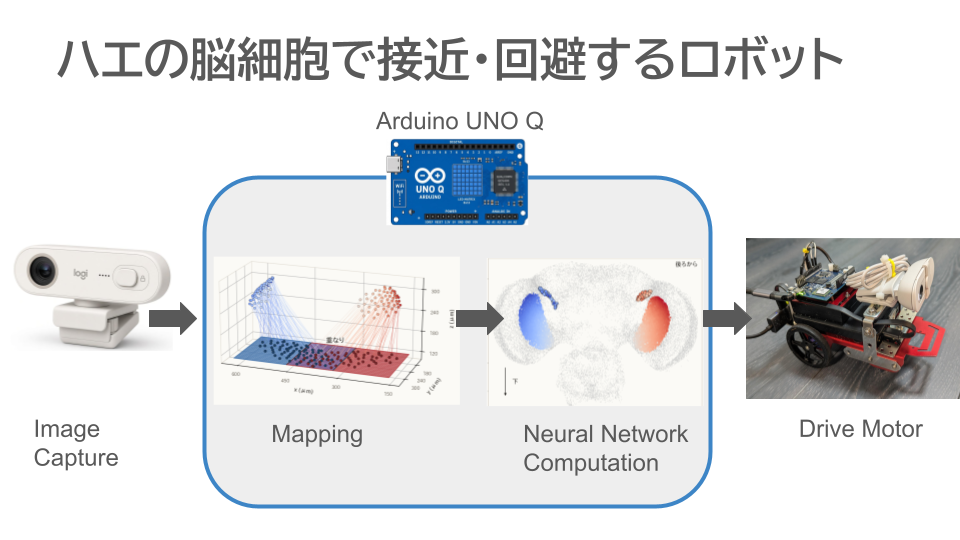
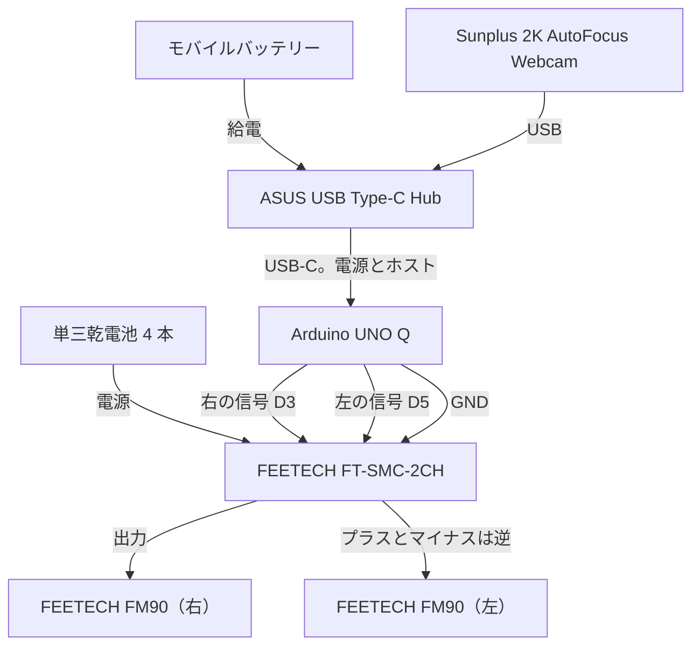
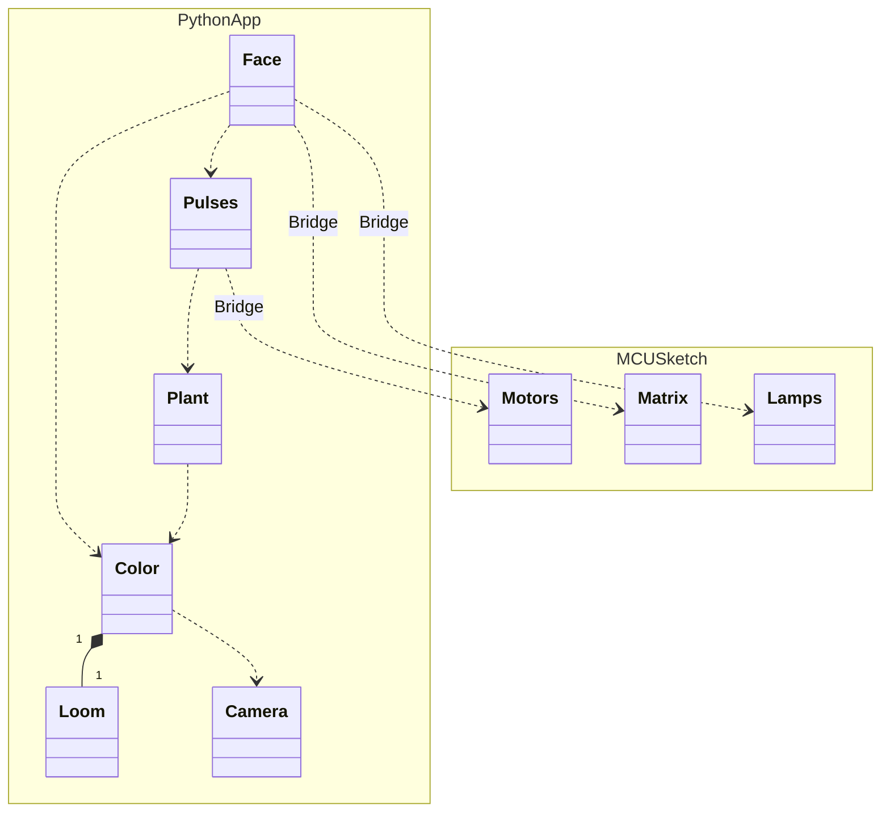
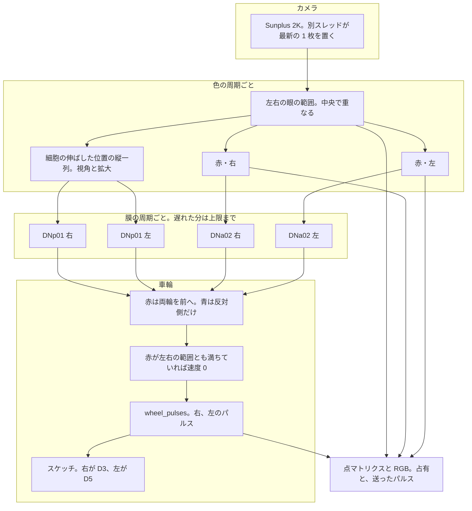
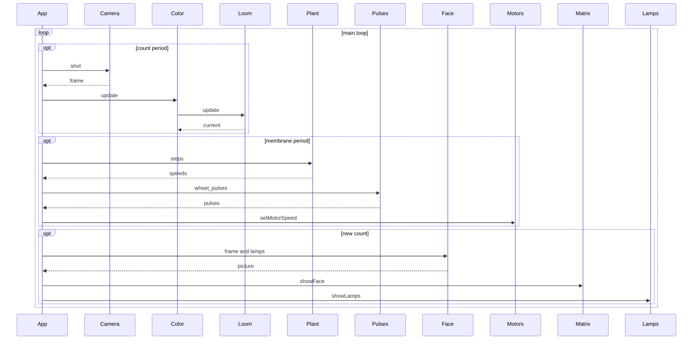

# システム構成

# ハードウェアコンポーネント

部品は次のとおりである。

| 部品 | 数量 | 備考 |
| --- | --- | --- |
| Arduino UNO Q | 1 | |
| Sunplus 2K AutoFocus Webcam | 1 | USB Web カメラ |
| ASUS USB Type-C Hub | 1 | |
| FEETECH FT-SMC-2CH | 1 | 2WD Mini Robot Mobile Platform Kit |
| FEETECH FM90 |2 | 2WD Mini Robot Mobile Platform Kit |
| モバイルバッテリー | 1 | |
| 単三乾電池 | 4 | |

# ソフトウェアコンポーネント

主要クラスのクラス図を記載する。

各クラスの役割は次のとおりである。

| クラス | 役割 |
| --- | --- |
| Camera | 最新の 1 枚を置く |
| Color | 左右の眼の赤と青を数える |
| Loom | 青の拡大から電流を出す |
| Plant | 膜と車輪のフィルタを進める |
| Pulses | 速さをパルスにする |
| Face | 絵とランプの色を決める |
| Motors | パルスを車輪に書く |
| Matrix | 点マトリクスを灯す |
| Lamps | RGB を灯す |

# データフロー

# シーケンス

# 数理モデル

1. カメラ画像から電流を計算
    - 逃避の電流=α(拡大の強さ×同側LC4の青の割合+視角の大きさ×同側LPLC2の青の割合)
    - 接近の電流=α(同側の赤のPN−β×反対側の赤のPN)
2. 膜電位の時間発展
    - V←V+⊿t(-V+I)/τ
    - r=Vの発火率
3. モーターへの指令に変換
    - 左モーターへの指令=k(右接近発火率 - 右逃避の発火率)
    - 右モーターへの指令=k(左接近発火率 - 左逃避の発火率)

フルバージョンは Github リポジトリ中の [poster.md](https://github.com/hamling-ling/fly-car/blob/main/poster/poster.md) をご覧ください。

# まとめ

コネクトームと生物学的知見に基づくモデルにより、赤（接近）・青（逃避）の単純な視覚入力から、ハエの接近・逃避に対応するロボット動作を実現・確認し、神経の接続と細胞特性を反映した実装例を提示しました。
