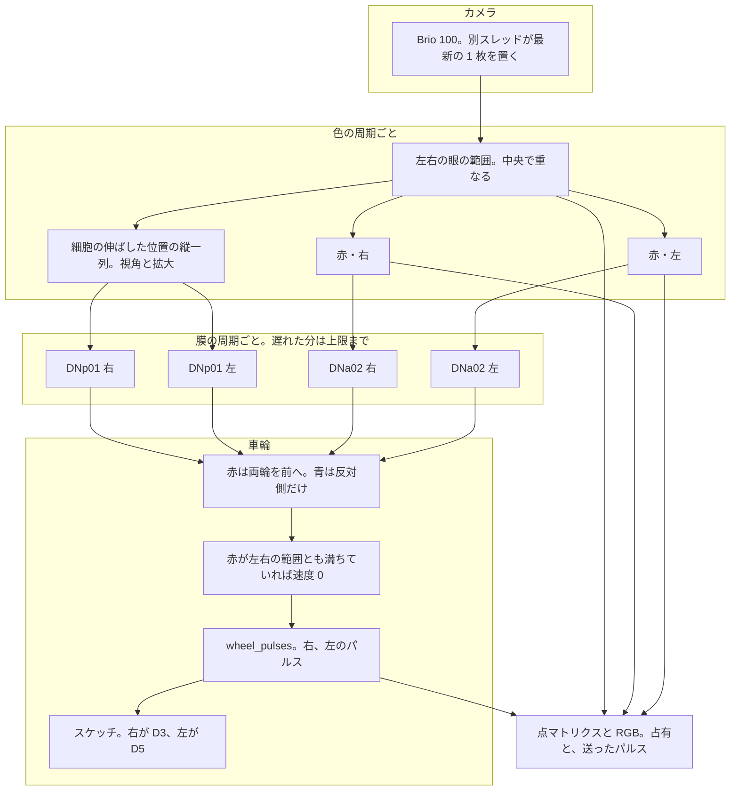

# flycar_q

Uno Q に載せる本番のアプリ。最新のフレームを左右の眼として読み、赤には近づき、広がる青からは下がる。膜と車輪のフィルタは `Plant.steps` が進める。色を数える周期と膜を進める周期は分かれていて、遅れた更新は開いた時間ぶん、上限まで進む。係数は `src/flycar/behavior.py` と `src/flycar/loom.py` の先頭にある。

## データフロー

このアプリは、最新の 1 枚から左右の眼の範囲の色を読む。範囲は中央で重なる。左の範囲は左端から重なりの先まで、右の範囲は重なりの手前から右端までである。画素の位置は左端から右端へ進む。赤の濃度は、その範囲にある赤の割合である。赤の画素が画面の端に寄るほど、左右の割合に同じ倍率を掛けた値をその濃度にする。中央では倍率は 1 で、割合はそのままである。青は、各細胞の画面位置にある縦一列の青の割合である。細胞の位置は、外側の端を固定して各眼の範囲を中央の向こうまで伸ばしたあとの位置である。細胞はまとめない。重みは細胞ごとのシナプス数のままである。

同側の PN が促進し、反対側の PN が抑制する電流が、同側の DNa02 に入る。その濃度は PN で飽和してからこの電流になる。DNp01 は赤を読まない。

逃避の電流は、同じ縦一列の青の割合から作る。LC4 は拡大の強さを掛ける。LPLC2 は、視角が広がっているあいだその割合を残す。広がっていないあいだは 0 にする。止まった紙のわずかな揺れは広がりに数えない。各型は自分の同側シナプス合計で割って、同側の DNp01 の電流になる。視角と拡大は、いちばん大きい青い領域の円から取る。LC4 と LPLC2 には膜を持たせない。

膜は左右の DNa02 と左右の DNp01 の 4 本で、同じ漏れ積分発火である。色を数える周期のあいだは電流を保ち、膜の周期ごとにその電流で膜と車輪のフィルタを進める。更新が遅れたときは、開いた時間と同じ長さだけ進める。長さには上限がある。`Plant.steps` は回数を省かれても、前回からの経過を同じ上限まで進める。青が消えた更新は、その開いた時間ぶんフィルタを進める。上限まで遅れていれば、後退の指令はその 1 回で送出が止まるところまで落ちる。両輪の前進は、左右の DNa02 の発火率の平均である。頭の回りは左右のその濃度の差で、右が多ければ左輪が速く、頭は右へ向く。割合がそろえば回りは 0 である。回りには上限があるので、片側だけの赤でも両輪は前へ出る。DNp01 は反対側の車輪だけを読む。指令は平滑してからパルスにする。DNa02 と DNp01 の膜のあいだに結合は無い。

止めた青紙は下がらない。拡大が無いからである。紙を近づけて視角が広がっているあいだだけ下がる。正面の青は左右がそろって発火し、両輪が同じ速さで後へ出る。横の青は青い側だけが発火し、反対の車輪が後へ出て、青い側の車輪は止まる。赤が左右の範囲とも満ちているときは、細胞が発火していても両輪を止める。左右がそろった赤は這う速さで前へ出る。片側だけの赤でも両輪が前へ出て、赤い側と反対の車輪が速い。頭はその赤へ向く。ログの `b` は、青が片側に寄っているかを残している。車輪はこの `b` を読まない。スケッチは受信が途切れると絵とランプを消し、動いている車輪も止める。青の 1 枚は色の周期より長くかかる。見えているあいだ更新は届くので、青のランプは点いたままになる。



絵が無い周回は `setMotorSpeed(0, 0)` を送り、膜は前の占有のまま進む。顔は占有を取り直した周回だけ出す。

## 動かし方

ボード上の置き場所は `~/ArduinoApps/flycar_q`。アプリだけだと `flycar` を import できない。パッケージも同じ `python/` に置く。リポジトリのどこからでも、次で止めて、コピーして、起動する。送り先は `arduino@uno-q-1.local` である。Python だけの更新は、コンパイル済みのスケッチと仮想環境を残して起動する。アプリのディレクトリはコンテナの `/app` に載るので、コピーした Python がその起動で動く。`app.yaml` か `sketch/` が変わったときは `.cache` を消してからコンパイルする。記録がまだ無いときは、今ある `.cache` を残す。直前の配置が同じスケッチをコンパイルしてあるからである。

```bash
scripts/deploy_flycar_q.sh
```

別のホストへ置くときは `scripts/deploy_flycar_q.sh arduino@<ホスト名>.local` とする。スケッチを必ず作り直すときは `scripts/deploy_flycar_q.sh --rebuild` とする。

手で起動するときは SSH で入る。起動コマンドはシェルに戻る。

```bash
ssh arduino@<ホスト名>.local
arduino-app-cli app start ~/ArduinoApps/flycar_q/
```

止めるときは、同じ SSH セッションで次を実行する。

```bash
arduino-app-cli app stop ~/ArduinoApps/flycar_q/
```

`No Colon In First Item Of Depfile` と出たら、スケッチのキャッシュが壊れている。消してから起動し直す。`scripts/deploy_flycar_q.sh --rebuild` も `.cache` を消してから起動する。

```bash
rm -rf ~/ArduinoApps/flycar_q/.cache
arduino-app-cli app start ~/ArduinoApps/flycar_q/
```

ログは PC で次を実行する。画面に流れ、同じ内容が `logs/flycar_q-日時.log` に残る。Ctrl-C で切る。ファイルは残る。`*.log` は git に入らない。

```bash
scripts/logs_flycar_q.sh
```

別のホストは `scripts/logs_flycar_q.sh arduino@<ホスト名>.local` とする。

止まっているあいだは心拍の行だけ出す。青の電流、発火率、車輪のどれかがあるあいだは細かく出し、指令が変わったときにも出す。周期は `python/config.py` にある。行には、左右の眼の範囲の赤と青の割合、左右の DNp01 電流、`b`、弱い電流 / 強い電流（`ratio`）、DNp01 と DNa02 の発火率、視角、拡大速度、経路速度 `v`、ヨー `yaw`、送る前の車輪速度とパルス（`wheel` と `raw`）、送ったパルス、モードが並ぶ。心拍の行には、その窓のカメラ取得と `Plant.steps` の時間、進めた膜の回数も付く。`b` は記録だけで、車輪は読まない。色が写っている行、または車輪か発火がある行には `img` が付く。これはその行が数えたフレームの JPEG で、ボードの `~/ArduinoApps/flycar_q/frames/` に書かれる。同じ取り込みは 1 枚だけなので、カメラが同じ絵を繰り返しているあいだは複数の行が同じ `img` を指す。アプリを起動し直すと、前の JPEG は消える。`scripts/logs_flycar_q.sh` を Ctrl-C で止めると、ボードの `frames/` にある JPEG を `logs/flycar_q-日時/` へコピーし、コピーし終えたファイルをボードから消す。届いた大きさがボードと違うファイルは消さない。

ボード上で見るときは、SSH の先で次を実行する。

```bash
arduino-app-cli app logs ~/ArduinoApps/flycar_q/ --follow --tail 30
```

`scripts/deploy_flycar_q.sh` はアプリを止めて、コピーして、残っているコンテナを消してから起動する。Python だけの更新は `.cache` を残し、仮想環境とスケッチのビルドを次の起動が使う。`app.yaml` か `sketch/` が `~/ArduinoApps/flycar_q/.sketch-hash` と違うとき、または `--rebuild` のときは `.cache` を消してコンパイルする。その記録は起動が成功したあとに書く。`app start` は、同じアプリのコンテナが running か starting だと受け付けない。

カメラのつなぎ方は [camera_capture_q](../../research/camera_capture_q/README.md) と同じ。USB-C を PC に刺したデバイスモードではカメラは列挙されない。給電できるハブの先に Brio 100 を置く。

## 周期

フレームを取るループと、膜のループは分けてある。暗い部屋ではシャッターが伸び、読み出しを膜の更新の中で待つと膜が止まる。

| 役割 | 処理 |
| --- | --- |
| カメラ | 最新の 1 枚を覚えておく。読み出しが止まったら、同じ大きさの MJPG で開き直す。大きさが違うあいだは、そのオープンを捨て、カメラを繋ぎ直してからもう一度開く。アプリはそこでは終わらない。取り込みが粗いときは同じ絵を繰り返し、細かいときは間引く |
| 色 | その絵から左右の眼の範囲の赤と、青の視角・拡大を作り直す |
| 膜 | `Plant.steps` を 1 回呼び、パルスをスケッチへ送る |

色の周期と膜の周期は `python/config.py` にある。起動直後、露出が上がるまでのフレームは指令を出さない。スケッチはパルスが来なくなると車輪を止める。Python が落ちたときも車輪は止まる。

## LED マトリクス

基板の点マトリクスに、ログと同じ状態を色の周期ごとに出す。基板の下辺が車の前なので、絵は回してある。後ろから見ると下が前、左が車の左。点マトリクスの LED は青だけなので、色は隣の RGB で出す。LED3 が見ている色で、赤が写っていれば赤、青が写っていれば青。青のランプは割合で、DNp01 が発火しているかどうかではない。止まった青でもランプは点く。LED4 が車輪で、前進は赤、後退は青。どちらも出ているときは両方点く。起動直後、最初の絵が来るまでは前の左の 1 点だけが点く。受信が途切れると、点もランプも消える。止めるときも消灯を送る。

```
後ろから見る。下が車の前。

行0  左輪の後退    ・  右輪の後退
行1  左輪の前進    ・  右輪の前進
行2
行3  青・左        ・  青・右
行4  青・左        ・  青・右
行5
行6  赤・左        ・  赤・右
行7  赤・左        ・  赤・右
```

占有のバーは外側から中央の仕切りへ伸びる。小さな割合は消灯のままで、そこから段階的に点を増やす。段階は `python/face.py` にある。車輪は送ったあとのパルスで、動き出しに届かない指令は消灯のままである。仕切りは床を掛ける前のモードで、`cruise` は前の端、`back` は後ろの端、`spin` はその両方、`stop` は消灯。赤が左右の範囲とも満ちているときは仕切りを全部点ける。

## 色とパルス

色の範囲は `src/flycar/color_thresholds.json` で、`occupancy.py` が読み込む。`research/color_capture_q/fit_thresholds.py` が色紙からこのファイルを書く。ファイルを替えたらアプリを起動し直す。ボードへは `src/flycar` ごとコピーする。OpenCV の色相は度の半分で、ここでの角度は一周を度で読む。色紙の赤は入る。スマホの薄い水色は入らない。同じ色相と彩度のモニタや本の背は青になる。肌、クリーム色の壁、オレンジの画面、木のドアは赤に入らない。顔のバーは小さな割合を消灯にする。膜はその割合を空にしない。

速度からパルスへの対応は `src/flycar/pulse.py` にある。強い前進は、ラジコンで気持ちよく走った指令に合わせてある。左右がそろった赤の前進は、それより遅い這う速さになる。送信の直前に、テーブルで車輪が動き出した下限を掛ける。前進は下限に届かなければ止める。後退は下限のぶんだけずらす。0 はそのままである。ログの `pulse` は、折れ線とこの処理のあとにスケッチへ送った値である。片輪だけが下限の内側なら、その輪だけ止まる。

画面の左が車の右になる取り付けなら、`python/config.py` の `MIRROR` を `True` にする。

## ファイル

| 場所 | 内容 |
| --- | --- |
| `python/main.py` | 色の周期と膜の周期のループ |
| `python/camera.py` | Brio を開き、最新フレームを置く |
| `python/face.py` | 占有とパルスから点マトリクスの絵を作る |
| `python/motors.py` | `setMotorSpeed` をスケッチへ送る |
| `python/config.py` | 左右反転と、上の二つの周期 |
| `python/bootstrap.py` | `flycar` の import 先を足す |
| `sketch/sketch.ino` | Bridge の登録と `loop` |
| `sketch/motors.cpp` | ピン、パルス、無受信停止 |
| `sketch/face.cpp` | 絵と RGB を書き、受信が途切れたら消す |
| `src/flycar` | 占有、loom の電流、膜、速度からパルス。細胞表は `loom_cells.npz`。色の範囲は `color_thresholds.json` |

## 車輪

右がピン D3、左がピン D5。指令の正は前進で、パルス幅の中央が停止である。左モーターの配線は逆なので、正の指令は左右とも停止より長いパルスにする。右はそのパルスで前進し、左は配線が逆なので同じ側のパルスで前へ回る。`setMotorSpeed` の引数は右、左の順。正のヨーは左旋回なので、そのとき左のパルスが右より小さい。反時計回りだけ広げる倍率は掛けない。`research/motor_test`、`research/remote_control`、`research/motor_adjust` のスケッチも同じ式である。下限を掛けるのはこのアプリの Python だけで、ラジコンは動き出しの下限を掛けない。このアプリは送信直前に、左の指令を直進の折れ線へ通す。右は走行則のパルスのままである。左の 0 は 0 のまま残す。旋回では、右の値ではなく、左が頼まれたパルスをその向きの折れ線に通す。折れ線のあとで、前進は動き出しに届かなければ止め、後退は動き出しのぶんだけずらす。ラジコンが折れ線をオンにしているときも、直進の左を右から計算し直してから送る。`motor_adjust` はページの数を、そのまま `setMotorSpeed` の大きさにする。
