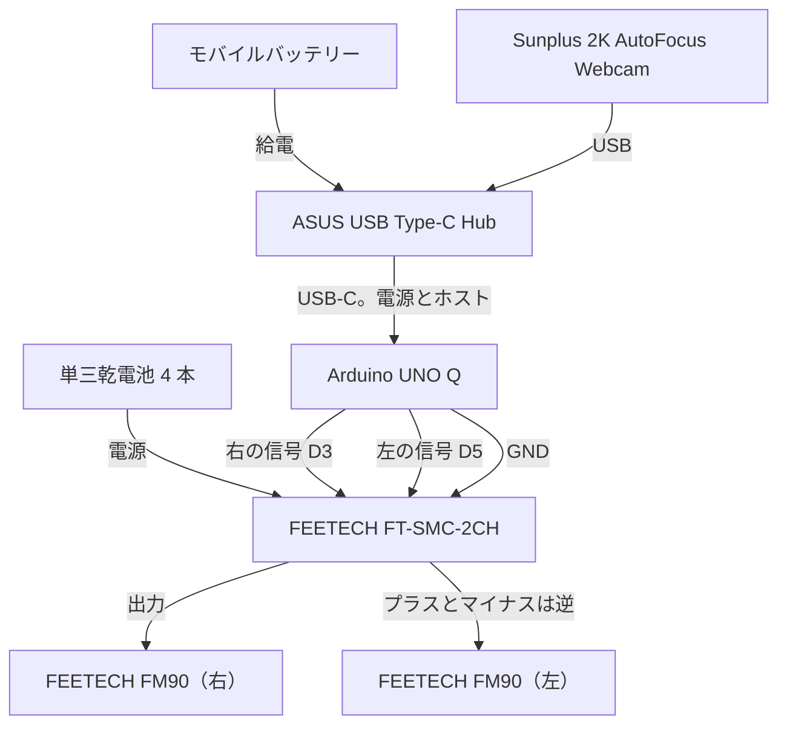
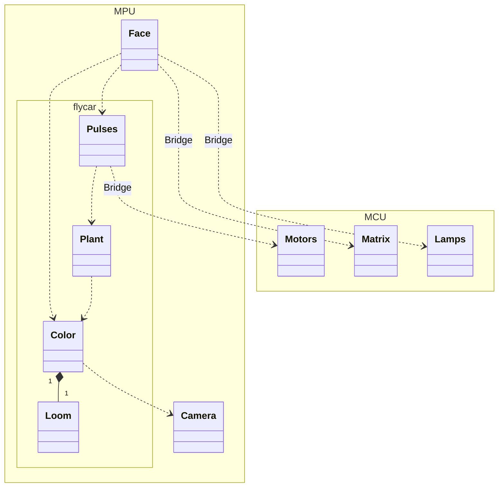
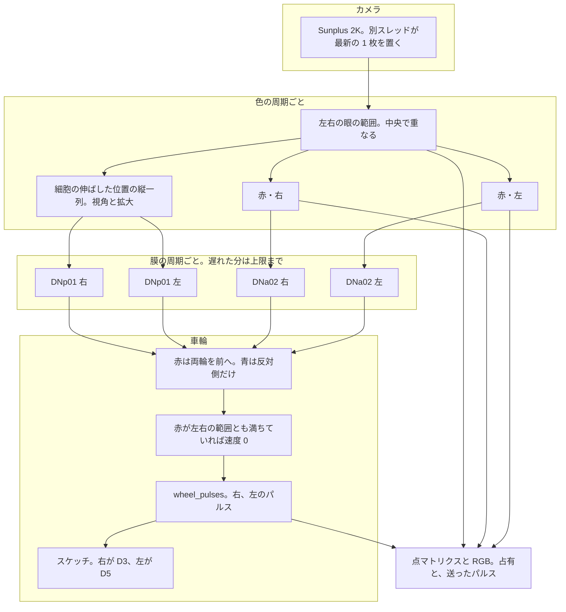
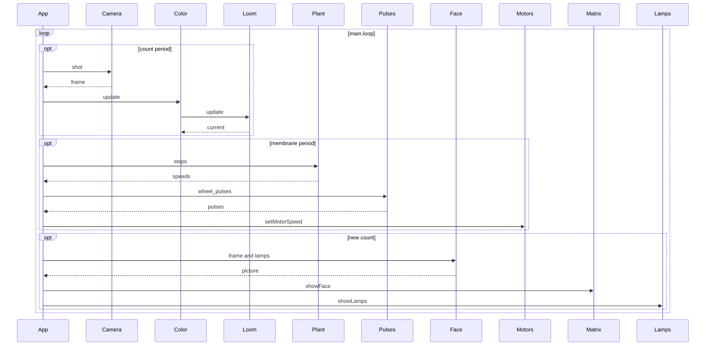

# flycar_q

Arduino Uno Q に載せる本番のアプリ。カメラの最新フレームを左右の眼として読み、赤には近づき、広がる青からは下がる。色を数える処理と膜を進める処理は別の周期で回り、膜は遅れた分を開いた時間だけ、上限までまとめて進める。モデルの係数は `src/flycar/behavior.py` と `src/flycar/loom.py` の先頭にある。

## 動かし方

配置と起動はスクリプトで行う。リポジトリのどこからでも実行でき、送り先は `arduino@uno-q-1.local` である。

```bash
scripts/deploy_flycar_q.sh
```

- 別のホストへ置くとき: `scripts/deploy_flycar_q.sh arduino@<ホスト名>.local`
- スケッチを必ず作り直すとき: `--rebuild`
- フレームの JPEG を書かずに起動するとき: `--no-jpeg`（`--rebuild` と一緒に付けられる）

手で起動・停止するときは SSH で入る。起動コマンドはシェルに戻る。

```bash
ssh arduino@<ホスト名>.local
arduino-app-cli app start ~/ArduinoApps/flycar_q/
arduino-app-cli app stop ~/ArduinoApps/flycar_q/
```

ログは PC で取る。画面に流れ、同じ内容が `logs/flycar_q-日時.log` に残る（`*.log` は git に入らない）。

```bash
scripts/logs_flycar_q.sh
```

ボード上で見る場合は `arduino-app-cli app logs ~/ArduinoApps/flycar_q/ --follow --tail 30`。

`No Colon In First Item Of Depfile` と出たら、スケッチのキャッシュが壊れている。消してから起動し直す。

```bash
rm -rf ~/ArduinoApps/flycar_q/.cache
arduino-app-cli app start ~/ArduinoApps/flycar_q/
```

### 配置の仕組み

ボード上の置き場所は `~/ArduinoApps/flycar_q`。アプリだけでは `flycar` を import できないため、パッケージも同じ `python/` に置く。アプリのディレクトリはコンテナの `/app` に載るので、コピーした Python はその起動で動く。

deploy スクリプトはアプリを止めて、コピーして、残っているコンテナを消してから起動する。Python だけの更新では `.cache` を残し、仮想環境とコンパイル済みのスケッチを次の起動が使う。`app.yaml` か `sketch/` が `~/ArduinoApps/flycar_q/.sketch-hash` の記録と違うとき、または `--rebuild` のときは `.cache` を消してコンパイルする。記録は起動が成功したあとに書く。`app start` は、同じアプリのコンテナが running か starting のあいだは受け付けない。

## コンポーネント

車の中心は Arduino UNO Q で、カメラと車輪は別の電源から取る。

電源と USB はハブに集まる。モバイルバッテリーがハブの Power Delivery 入力に刺さり、ハブが UNO Q と Sunplus 2K AutoFocus Webcam と自分自身に給電する。UNO Q の USB-C はこのハブにつながる。USB-C が一つしかなく、電源とカメラを同じ口に載せるため、UNO Q からハブへの給電はしない。USB-C を PC に刺すデバイスモードでは、ホストのバスが空になるのでカメラは列挙されない。

車輪は秋月電子通商の 2WD Mini Robot Mobile Platform Kit の部品である。FEETECH FT-SMC-2CH が二つの FEETECH FM90 を回し、電源は単三乾電池 4 本で、UNO Q の 5 V は使わない（モーターの電流を UNO Q から取らないため）。UNO Q から FT-SMC-2CH へは、右の信号 D3、左の信号 D5、GND をつなぐ。左の FM90 はプラスとマイナスを逆につないである。



| 部品 | 数量 | 備考 |
| --- | --- | --- |
| Arduino UNO Q | 1 | |
| Sunplus 2K AutoFocus Webcam | 1 | USB Web カメラ |
| ASUS USB Type-C Hub | 1 | |
| FEETECH FT-SMC-2CH | 1 | 秋月電子通商の 2WD Mini Robot Mobile Platform Kit |
| FEETECH FM90| 2 | 秋月電子通商の 2WD Mini Robot Mobile Platform Kit |
| モバイルバッテリー | 1 | |
| 単三乾電池 | 4 | |

カメラは当初 Logitech Brio 100（対角 58°）を使い、現在は Sunplus 2K AutoFocus Webcam（対角 90°）である。画角の値は `src/flycar/loom.py` の `DFOV_DEG` で与える。

カメラのつなぎ方の詳細は [camera_capture_q](../../research/camera_capture_q/README.md) と同じ。給電できるハブの先にカメラを置く。

## ソフトウェア構成

ソフトウェアは UNO Q の中で、MPU の Python と MCU のスケッチに分かれる。モデルの計算（Color、Loom、Plant、Pulses）は `flycar` パッケージにあり、アプリの Python が import する。Camera と Face はアプリ側にある。`flycar` は Bridge を呼ばない。パルスと絵をスケッチへ渡すのは、アプリのループの役目である。



| クラス | 役割 |
| --- | --- |
| Camera | 最新の 1 枚を置く |
| Color | 左右の眼の赤と青を数える |
| Loom | 青の拡大から電流を出す |
| Plant | 膜と車輪のフィルタを進める |
| Pulses | 速さをパルスにする |
| Face | 絵とランプの色を決める |
| Motors | パルスを車輪に書く |
| Matrix | 点マトリクスを灯す |
| Lamps | RGB を灯す |

## データフロー

### 色を読む

最新の 1 枚を、左右の眼の範囲で読む。範囲は中央で重なり、左は左端から 0.65 まで、右は 0.35 から右端までである。

赤の濃度は、各範囲にある赤の割合である。ただし赤の重心が端に寄るほど、左右の割合の両方に同じ倍率が掛かる（中央では 1）。この濃度が PN で飽和し、同側の PN が促進、反対側の PN が抑制として、同側の DNa02 の電流になる。DNp01 は赤を読まない。画面に対して `loom.py` の `BLUE_MIN_FRACTION` 未満の塊は、赤の割合にも青の割合にも入れない。

青は、LC4 と LPLC2 の各細胞の画面位置にある、縦一列の青の割合を読む。細胞の位置は、外側の端を固定して各眼の範囲を中央の向こうまで伸ばしたあとの位置で、細胞はまとめず、重みは細胞ごとのシナプス数のままである。視角と拡大は、いちばん大きい青い領域を円とみなして取る。

### 電流から車輪まで

逃避の電流は、同じ縦一列の割合から作る。LC4 は拡大の強さを掛ける。LPLC2 は、視角が広がっているあいだ割合を残し、広がっていないあいだは 0 にする。止まった紙のわずかな揺れは広がりに数えない。各型の応答は、その型の同側シナプス合計で割って、同側の DNp01 の電流になる。LC4 と LPLC2 自体に膜は無い。

膜は左右の DNa02 と左右の DNp01 の四本で、すべて同じ漏れ積分発火であり、膜同士の結合は無い。色を数える周期のあいだ電流は保たれ、膜の周期ごとに、その電流で膜と車輪のフィルタが進む。

車輪は発火率だけを読む。左の車輪は右の DNa02 の発火率から右の DNp01 の発火率を引き、右の車輪は左右を入れ替えて読む。指令は平滑してからパルスにする。平滑のあと、回転が安全上限を超えたときだけ、平均の速さを保って左右の差を縮める。この上限は通常の接近と逃避では働かない。赤が左右の範囲とも満ちているときは、細胞が発火していても両輪を止める。

振る舞いとしてまとめると:

- 赤が片側だけにあると、赤い側の車輪が止まり、反対の車輪が前へ出て、頭は赤へ向く。左右の発火率がそろえば、両輪は同じ速さで前へ出る
- 止めた青紙には下がらない。紙を近づけて視角が広がっているあいだだけ下がる
- 正面の青では左右がそろって発火し、両輪が同じ速さで後へ出る。横の青では青い側だけが発火し、反対の車輪が後へ出て、青い側の車輪は止まる



フレームが無い周回は `setMotorSpeed(0, 0)` を送り、膜は前の占有のまま進む。顔（点マトリクスとランプ）は、占有を取り直した周回だけ出す。スケッチは受信が途切れると、絵とランプを消し、動いている車輪も止める。

## シーケンス

`main.loop` は `while True` で、色の周期と膜の周期を回す。二つの時計は別である。膜の周期は、直前に取り直した色の結果を Plant に渡す。



## 周期

フレームを取るループと膜のループを分けてあるのは、暗い部屋でシャッターが伸びたとき、読み出しを膜の更新の中で待つと膜まで止まってしまうからである。カメラは別スレッドで最新の 1 枚を置き続ける。

| 役割 | 処理 |
| --- | --- |
| カメラ | 最新の 1 枚を覚えておく。読み出しが止まったら、同じ大きさの MJPG で開き直す。大きさが違うあいだは、そのオープンを捨て、カメラを繋ぎ直してからもう一度開く。アプリはそこでは終わらない。取り込みの間隔より色の周期が粗いときは間引かれ、細かいときは同じ絵が繰り返し読まれる |
| 色 | その絵から左右の眼の範囲の赤と、青の視角・拡大を作り直す |
| 膜 | `Plant.steps` を 1 回呼び、パルスをスケッチへ送る |

色の周期（`COUNT_S`）と膜の周期（`TICK_S`）は `python/config.py` にある。更新が遅れたとき、膜は開いた時間と同じ長さだけ進める。長さには上限があり、上限まで遅れた更新では、その間にフィルタが進み切って、後退の指令が送出前に消えることもある。起動直後は、露出が上がるまでのフレームでは指令を出さない。スケッチはパルスが来なくなると車輪を止めるので、Python が落ちたときも車輪は止まる。

## ログ

止まっているあいだは心拍の行だけを出す。青の電流、発火率、車輪のどれかがあるあいだは細かく出し、指令が変わったときにも出す。周期は `python/config.py` にある。

行には、左右の眼の範囲の赤と青の割合、左右の DNp01 電流、`b`、弱い電流 / 強い電流（`ratio`）、DNp01 と DNa02 の発火率、視角、拡大速度、経路速度 `v`、ヨー `yaw`、送る前の車輪速度とパルス（`wheel` と `raw`）、送ったパルス、モードが並ぶ。心拍の行には、その窓のカメラ取得（`cam`）と `Plant.steps` の時間（`steps`）、進めた膜の回数（`n`）も付く。`b` は青が片側に寄っているかの記録で、車輪は読まない。

例:

```
[main] red 0.09 0.05  blue 0.00 0.00  I 0.00 0.00  b 1  ratio 0.00  DNp 0 0  DNa 131 71  deg 0  exp 0.0  v 0.084  yaw 0.47  wheel R:0.112 L:0.056  raw R:90 L:45  pulse R:90 L:39  cruise  cam 15.1 fps  steps 18.84 ms  n 653  img 20261115-041643-270-11952
```

### フレームの JPEG

色が写っている行、または車輪か発火がある行には `img` が付く。その行が数えたフレームの JPEG で、ボードの `~/ArduinoApps/flycar_q/frames/` に書かれる。同じ取り込みは 1 枚だけなので、カメラが同じ絵を繰り返しているあいだは、複数の行が同じ `img` を指す。JPEG を書く起動では、起動時に前の JPEG は消える。

`scripts/logs_flycar_q.sh` を Ctrl-C で止めると、ボードの `frames/` にある JPEG を `logs/flycar_q-日時/` へコピーし、コピーし終えたファイルをボードから消す。届いた大きさがボードと違うファイルは消さない。

JPEG を書かずに走らせるには、アプリのディレクトリへ空ファイル `no-jpeg` を置いてから起動する。その走行は `frames/` を作らず、前の JPEG も消さず、ログに `img` を付けない。起動時のログは `camera: JPEG は書かない` である。ファイルを消して起動し直すと、また `frames/` へ書く。`scripts/deploy_flycar_q.sh --no-jpeg` は、コピーのあとでそのファイルを置いて起動する。このオプションの無い配置は、ボードに残っている `no-jpeg` を消してから起動する。手で切り替えるときは、SSH の先で `touch ~/ArduinoApps/flycar_q/no-jpeg` か `rm -f ~/ArduinoApps/flycar_q/no-jpeg` をしてから、止めて、起動する。

## LED マトリクス

基板の点マトリクスに、ログと同じ状態を色の周期ごとに出す。基板の下辺が車の前なので、絵は回してある。後ろから見ると下が前、左が車の左。点マトリクスの LED は青だけなので、色は隣の RGB で出す。

LED3 が見ている色で、赤が写っていれば赤、青が写っていれば青。青のランプは割合を表し、DNp01 が発火しているかどうかではない。止まった青でもランプは点く。LED4 が車輪で、前進は赤、後退は青。どちらも出ているときは両方点く。起動直後、最初の絵が来るまでは前の左の 1 点だけが点く。受信が途切れると、点もランプも消える。止めるときも消灯を送る。

```
後ろから見る。下が車の前。

行0  左輪の後退    ・  右輪の後退
行1  左輪の前進    ・  右輪の前進
行2
行3  青・左        ・  青・右
行4  青・左        ・  青・右
行5
行6  赤・左        ・  赤・右
行7  赤・左        ・  赤・右
```

占有のバーは外側から中央の仕切りへ伸びる。小さな割合は消灯のままで、そこから段階的に点を増やす。段階は `python/face.py` にある。車輪は送ったあとのパルスで、動き出しに届かない指令は消灯のままである。仕切りは、床を掛ける前のモードを表す。`cruise` は前の端、`back` は後ろの端、`spin` はその両方、`stop` は消灯。赤が左右の範囲とも満ちているときは仕切りを全部点ける。

## 色とパルス

色の範囲は `src/flycar/color_thresholds.json` で、`occupancy.py` が読み込む。`research/color_capture_q/fit_thresholds.py` が色紙からこのファイルを書く。ファイルを替えたらアプリを起動し直す。ボードへは `src/flycar` ごとコピーする。OpenCV の色相は度の半分で、ここでの角度は一周を度で読む。

色紙の赤は入る。スマホの薄い水色は入らない。同じ色相と彩度のモニタや本の背は青になる。肌、クリーム色の壁、オレンジの画面、木のドアは赤に入らない。顔のバーは小さな割合を消灯にするが、膜はその割合を空にしない。

速度からパルスへの対応は `src/flycar/pulse.py` にある。強い前進は、ラジコンで気持ちよく走った指令に合わせてある。左右がそろった赤の前進は、それより遅い這う速さになる。送信の直前に、車輪が動き出す下限の処理を掛ける。前進は下限に届かなければ止め、後退は下限のぶんだけずらす。0 はそのままである。片輪だけが下限の内側なら、その輪だけ止まる。ログの `pulse` は、折れ線とこの処理のあとにスケッチへ送った値である。

画面の左が車の右になる取り付けなら、`python/config.py` の `MIRROR` を `True` にする。

## 車輪

右がピン D3、左がピン D5。指令の正は前進で、パルス幅の中央が停止である。左モーターの配線は逆なので、正の指令は左右とも停止より長いパルスにする。右はそのパルスで前進し、左は配線が逆なので同じ向きのパルスで前へ回る。`setMotorSpeed` の引数は右、左の順である。正のヨーは左旋回で、そのとき左のパルスは右より小さい。

このアプリは送信直前に、左の指令だけを直進の折れ線へ通す。右は走行則のパルスのままである。左の 0 は 0 のまま残す。旋回のときも、右の値からではなく、左が頼まれたパルスをその向きの折れ線に通す。前進が動き出しに届くかどうかは、折れ線の前の、走行則のパルスで左右とも判断する。届かなければ止め、届いた左が折れ線で下限を割ったときは下限まで戻す。折れ線のあとで判断すると、走行則の 13〜16 で左だけが止まり、発進と停止で車が左へ振れていた。後退は折れ線のあとで動き出しのぶんだけずらす。

下限の処理を掛けるのはこのアプリの Python だけで、ラジコンは掛けない。ラジコンが折れ線をオンにしているときも、直進の左は右から計算し直して送る。`research/motor_test`、`research/remote_control`、`research/motor_adjust` のスケッチも、パルス幅の式は同じである。`motor_adjust` はページの数を、そのまま `setMotorSpeed` の大きさにする。

## ファイル

| 場所 | 内容 |
| --- | --- |
| `python/main.py` | 色の周期と膜の周期のループ |
| `python/camera.py` | Sunplus 2K を開き、最新フレームを置く |
| `python/face.py` | 占有とパルスから点マトリクスの絵を作る |
| `python/motors.py` | `setMotorSpeed` をスケッチへ送る |
| `python/config.py` | 左右反転と、上の二つの周期 |
| `python/bootstrap.py` | `flycar` の import 先を足す |
| `sketch/sketch.ino` | Bridge の登録と `loop` |
| `sketch/motors.cpp` | ピン、パルス、無受信停止 |
| `sketch/face.cpp` | 絵と RGB を書き、受信が途切れたら消す |
| `src/flycar` | 占有、loom の電流、膜、速度からパルス。細胞表は `loom_cells.npz`。色の範囲は `color_thresholds.json` |
