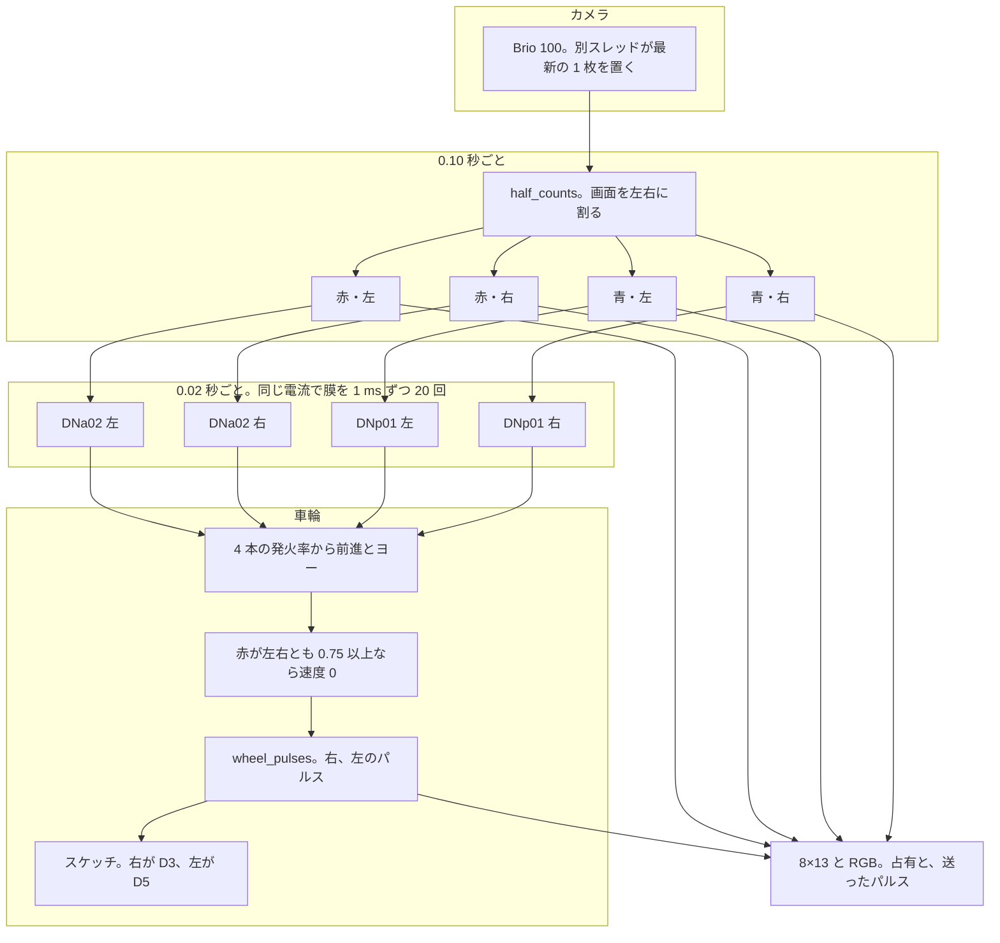

# flycar_q

Uno Q に載せる本番のアプリ。最新のフレームから左右の赤と青の占有を作り、`Plant.steps` で 20 ms 分の膜を進めて、左右のタイヤを回す。

## データフロー

このアプリは、最新の 1 枚から左右の赤と青の占有を作り、赤を同側の DNa02 の電流、青を同側の DNp01 の電流にするものである。0.02 秒ごとにその電流で 4 本の膜を 1 ms ずつ 20 回進め、発火率から前進とヨー、左右のパルスを作ってスケッチへ送る。DNa02 同士の化学シナプスは 0 本で、DNa02 と DNp01 のあいだも 0 本なので、4 本の膜のあいだに矢印は無い。

LC4 と LPLC2 は通さない。片側の細胞全部に、その半画面の占有から作った同じ発火率 $r$ を与え、同側の DNp01 への化学シナプス数で足すと、電流は次になる。

$$
I = \frac{\sum w}{W_{\mathrm{side}}} \cdot \frac{r}{R_{\mathrm{ref}}}
$$

側の細胞を全部入れると、第一因子は 1 になる。本数も、1 本ごとの重みも消えて、$I = r / R_{\mathrm{ref}}$ だけが残る。左右はそれぞれのシナプス合計 $W_{\mathrm{side}}$ で割る。右の合計は左より少ないが、側ごとに割るのでその差は電流に残らない。$r = R_{\mathrm{ref}} \times \tilde{c} / 0.04$ と置くと、この $I$ は `gf_current` の $\tilde{c} / 0.04$ と一致する。0.04 は `BLUE_REF` で、半画面の占有がこの値のとき電流が 1 になる。左右の占有が違っても、側ごとに同じ式になる。だから、細胞を通さなくても DNp01 の電流は同じである。

LC4 と LPLC2 にも膜を持たせてから DNp01 へ入れる経路は、この積和ではない。前段の発火率が頭打ちになり、同じ電流にはならない。結合表を細胞ごとに積分するのは `research/notebooks/gf_loom_sim.ipynb` で、このアプリの外にある。



絵が無い周回は `setMotorSpeed(0, 0)` を送り、膜は前の占有のまま進む。顔は占有を取り直した周回だけ出す。

## 動かし方

ボード上の置き場所は `~/ArduinoApps/flycar_q`。アプリだけだと `flycar` を import できない。パッケージも同じ `python/` に置く。リポジトリ直下で次を実行する。

```bash
scp -r src/flycar_q arduino@<ホスト名>.local:~/ArduinoApps/
scp -r src/flycar arduino@<ホスト名>.local:~/ArduinoApps/flycar_q/python/
```

SSH で入って起動する。起動コマンドはシェルに戻る。

```bash
ssh arduino@<ホスト名>.local
arduino-app-cli app start ~/ArduinoApps/flycar_q/
```

止めるときは、同じ SSH セッションで次を実行する。

```bash
arduino-app-cli app stop ~/ArduinoApps/flycar_q/
```

`No Colon In First Item Of Depfile` と出たら、スケッチのキャッシュが壊れている。消してから起動し直す。

```bash
rm -rf ~/ArduinoApps/flycar_q/.cache
arduino-app-cli app start ~/ArduinoApps/flycar_q/
```

ログは次で見る。1 秒に 1 行、左右の赤、左右の青、右と左のパルス、モード、その窓のカメラ取得 fps、`Plant.steps` の平均時間が出る。

```bash
arduino-app-cli app logs ~/ArduinoApps/flycar_q/ --tail 50
```

Python だけ直したときは、スケッチのキャッシュは消さなくてよい。止めてからコピーし、起動し直す。`src/flycar` を直したときも、上の 2 本目の `scp` をやり直す。

カメラのつなぎ方は [camera_capture_q](../../research/camera_capture_q/README.md) と同じ。USB-C を PC に刺したデバイスモードではカメラは列挙されない。給電できるハブの先に Brio 100 を置く。

## 周期

フレームを取るループと、膜のループは分けてある。暗い部屋ではシャッターが 250 ms まで伸び、読み出しを 20 ms の中で待つと膜が止まる。

| 周期 | 処理 |
| --- | --- |
| カメラの間隔 | 最新の 1 枚を覚えておく。4 fps なら同じ絵を繰り返し、30 fps なら間引く |
| 0.10 秒 | その絵から左右の赤と青を作り直す |
| 0.02 秒 | `Plant.steps` を 1 回呼び、パルスをスケッチへ送る |

起動直後の 20 フレームは指令を出さない。露出が上がる前の絵はほぼ黒い。

スケッチは 0.45 秒パルスが来ないと止める。Python が落ちたときも車輪は止まる。

## LED マトリクス

基板の 8×13 に、ログと同じ状態を 0.10 秒ごとに出す。基板の下辺が車の前なので、絵は 180 度回してある。後ろから見ると下が前、左が車の左。点マトリクスの LED は青だけなので、色は隣の RGB で出す。LED3 が見ている色で、赤が 0.04 以上なら赤、青が 0.04 以上なら青。LED4 が車輪で、前進は赤、後退は青。どちらも出ているときは両方点く。起動直後、最初の絵が来るまでは前の左の 1 点だけが点く。最後の絵から 0.45 秒経つと、点もランプも消える。止めるときも消灯を送る。

```
後ろから見る。下が車の前。

行0  左輪の後退    ・  右輪の後退
行1  左輪の前進    ・  右輪の前進
行2
行3  青・左        ・  青・右
行4  青・左        ・  青・右
行5
行6  赤・左        ・  赤・右
行7  赤・左        ・  赤・右
```

占有は 0.04 未満が消灯、0.04 で 1 点、以降 0.20、0.36、0.52、0.68、0.84 で 1 点ずつ増えて 6 点が上限。バーは外側から中央の仕切りへ伸びる。車輪は送ったあとのパルスで、前進は 13 未満、後退は −36 より大きい負を消灯にする。13 と −36 が 1 点、255 と −255 が 6 点。仕切りは床を掛ける前のモードで、`cruise` は前の端、`back` は後ろの端、`spin` はその両方。`stop` は消灯。赤が左右とも 0.75 以上のときは仕切りを 8 点とも点ける。

## まだ床で合わせる数

色の範囲は `src/flycar/color_thresholds.json` で、`occupancy.py` が読み込む。`research/color_capture_q/fit_thresholds.py` が色紙の4点からこのファイルを書く。ファイルを替えたらアプリを起動し直す。ボードへは `src/flycar` ごとコピーする。OpenCV の色相は度の半分で、ここでの角度は 0〜360 度。色紙の赤は色相 340 度付近に寄る。スマホの薄い水色は入らない。同じ色相と彩度のモニタや本の背は青になる。肌は彩度が 80 前後で外れ、クリーム色の壁と色相 42 度のオレンジ画面は赤に入らない。木のドアは色相 30 度で、この赤には入らない。半画面の 4% に届かない小さい画面は空のまま。床での走行はまだ合わせていない。

速度の倍率は `src/flycar/pulse.py`。正面の赤が落ち着く 0.20 m/s を、ラジコンで気持ちよく走ったパルス 160 に対応させている。送信の直前に、2026-10-17 のテーブルで車体が動き出した下限を掛ける。前進は 13 未満を 0 にし、後退は −36 より大きい負を 0 にする。13 は 1525 µs、−36 は 1430 µs である。ログの `pulse` は、折れ線と下限のあとにスケッチへ送った値である。0 は停止を送っている。片輪だけが下限の内側なら、その輪だけ 0 になる。

画面の左が車の右になる取り付けなら、`python/config.py` の `MIRROR` を `True` にする。

## ファイル

| 場所 | 内容 |
| --- | --- |
| `python/main.py` | 0.10 秒と 0.02 秒のループ |
| `python/camera.py` | Brio を開き、最新フレームを置く |
| `python/face.py` | 占有とパルスから 8×13 の絵を作る |
| `python/motors.py` | `setMotorSpeed` をスケッチへ送る |
| `python/config.py` | 左右反転と、上の二つの周期 |
| `python/bootstrap.py` | `flycar` の import 先を足す |
| `sketch/sketch.ino` | Bridge の登録と `loop` |
| `sketch/motors.cpp` | ピン、パルス、無受信停止 |
| `sketch/face.cpp` | 絵と RGB を書き、0.45 秒で消す |
| `src/flycar` | 占有、膜、m/s からパルス。色の下限は `color_thresholds.json` |

## 車輪

右がピン D3、左がピン D5。指令 -255〜255 を 1000〜2000 µs にする。1500 µs が停止。左モーターの +/- は逆つなぎなので、正の指令は左右とも 1500 µs より長いパルスにする。右はそのパルスで前進し、左は配線が逆なので同じ側のパルスで前へ回る。`setMotorSpeed` の引数は右、左の順。正のヨーは左旋回なので、そのとき左のパルスが右より小さい。反時計回りだけ広げる倍率は掛けない。`research/motor_test`、`research/remote_control`、`research/motor_adjust` のスケッチも同じ式である。下限を掛けるのはこのアプリの Python だけで、ラジコンは動き出しの下限を掛けない。このアプリは送信直前に、左の指令を直進の折れ線へ通す。右は走行則のパルスのままである。左の 0 は 0 のまま残す。旋回では、右の値ではなく、左が頼まれたパルスをその向きの折れ線に通す。直進で左右とも 160 なら、送るのは右 160、左 101 である。後退で左右とも 100 なら、右 −100、左 −92 である。折れ線のあとで、前進 13 未満と後退 −36 より大きい負を 0 にする。ラジコンが折れ線をオンにしているときも、直進の左を右から計算し直してから送る。`motor_adjust` はページの4つの数を、そのまま `setMotorSpeed` の大きさにする。
